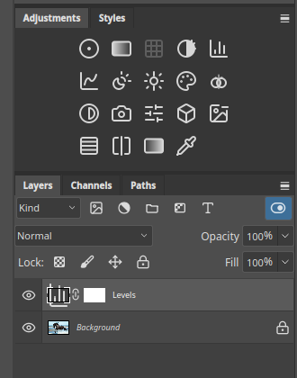
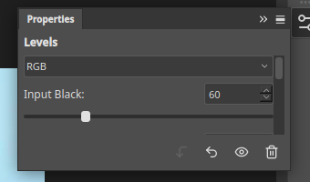
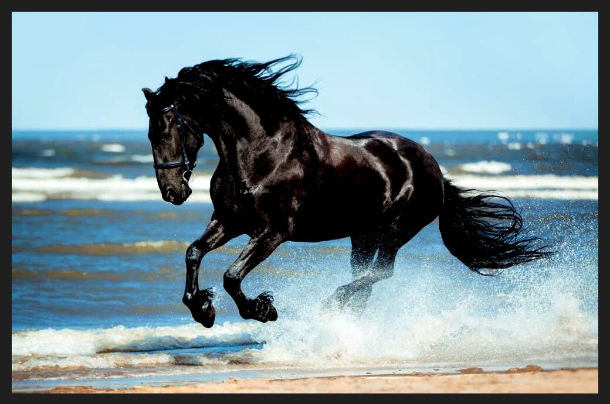
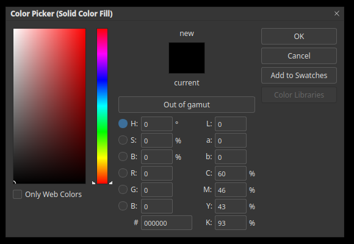

# Adjustment layers

An adjustment layer applies a correction to every layer beneath it, without changing
their pixels. You can change its settings, hide it, lower its strength or limit it with a
mask at any time. It is the best way to use [adjustments](adjustments.md).

## Add one

Click an icon in the **Adjustments** panel. The icons are, row by row, Brightness/Contrast,
Levels, Curves and others. Point at an icon to see its name. You can also use
**Layer ▸ New Adjustment Layer**.

The new layer appears in the **Layers** panel above the layer that was selected, with a
white **layer mask** next to it. Here a Levels layer sits on top of the Background.

## Change its settings

Click the adjustment layer, then open the **Properties** panel from the icon on the right of
the window. The panel shows the controls for that adjustment.

Below the controls are buttons to reset the adjustment, to hide it temporarily (the eye),
and to delete it.

## The result

The picture below has a Levels layer with the input black point raised to 60. The Background
layer is unchanged. Hide the adjustment layer with its eye to compare.

## Limit it with the mask

An adjustment layer's mask controls where it applies. Paint it black to keep the correction
away from part of the picture. See [Layer masks](layer-masks.md).

## Solid colour fills

The first icon in the Adjustments panel adds a **Solid Color** fill layer and opens the
colour picker. Fill layers work like adjustment layers, and are useful with
[blend modes](blend-modes.md).

