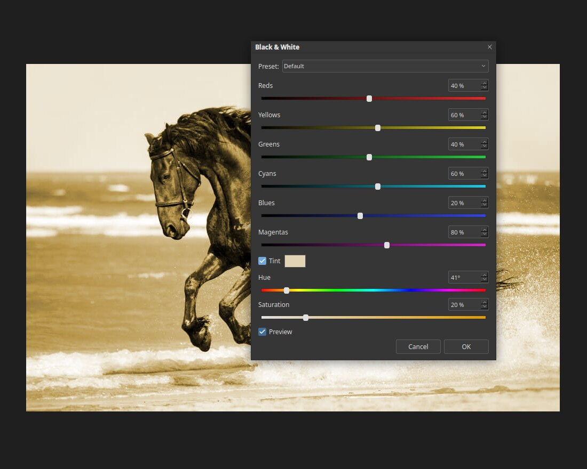

# Black & White

The Black & White adjustment turns a colour photo into monochrome, with control over how
bright each colour becomes. This gives a much better result than simply removing the
colour. Open it with **Image ▸ Adjustments ▸ Black & White…** or press `Ctrl+Alt+Shift+B`.

## The sliders

There is one slider for each of **Reds**, **Yellows**, **Greens**, **Cyans**, **Blues**
and **Magentas**. A slider decides how light that colour is in the grey result:

- Move it **right** to make areas of that colour lighter.
- Move it **left** to make them darker.

For example, lowering Blues makes a blue sky darker and the clouds stand out.

## Tint

Tick **Tint** to colour the picture with a single hue, using the **Hue** and **Saturation**
sliders. The example above uses a warm hue for a sepia effect. Click the colour swatch to
choose the tint colour.

## Other ways to get grey

**Image ▸ Adjustments ▸ Desaturate** (`Ctrl+Shift+U`) removes colour in one step with no
controls. Use Black & White when you want to decide how each colour looks.
