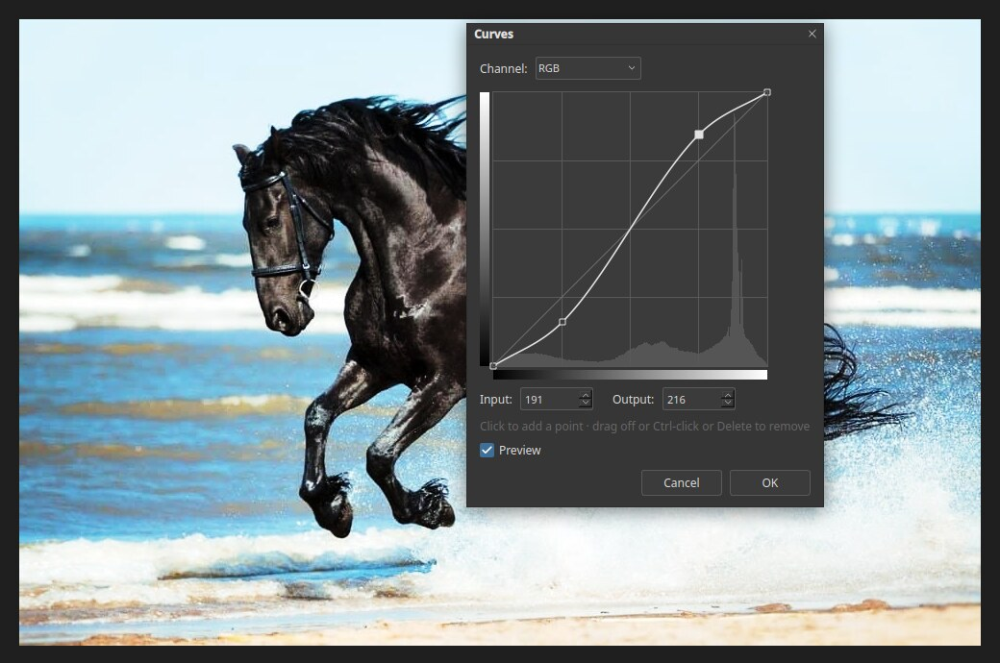

# Curves

Curves is the most precise tone tool. It lets you lighten, darken and add contrast
to exactly the tones you choose. Open it with **Image ▸ Adjustments ▸ Curves…** or
press `Ctrl+M`. To keep the edit changeable, use the Curves icon in the **Adjustments**
panel instead.

## Reading the graph

- The horizontal axis is the **input**: the tone the pixel has now, from black at the
  left to white at the right.
- The vertical axis is the **output**: the tone it will have afterwards.
- A straight diagonal line means no change.
- The grey shape behind the line is the histogram of the image, so you can see where
  its tones are.

## Using it

1. Pick a **Channel**. **RGB** changes overall tone. A single colour channel changes
   colour balance.
2. Click on the line to add a point, and drag the point. Dragging up makes those tones
   lighter; dragging down makes them darker.
3. Watch the photo, which updates live while **Preview** is ticked.
4. Click **OK** to apply, or **Cancel** to leave the image alone.

The **Input** and **Output** boxes show and set the exact values of the selected point.
To remove a point, drag it off the graph, or `Ctrl`-click it, or press `Delete`.

## A good first curve

The picture above uses a gentle **S-curve**: one point pulled down in the shadows and one
pulled up in the highlights. Darks get darker and lights get lighter, which adds contrast
without changing the colours much.

Use the same idea in reverse for a flat, faded look.
