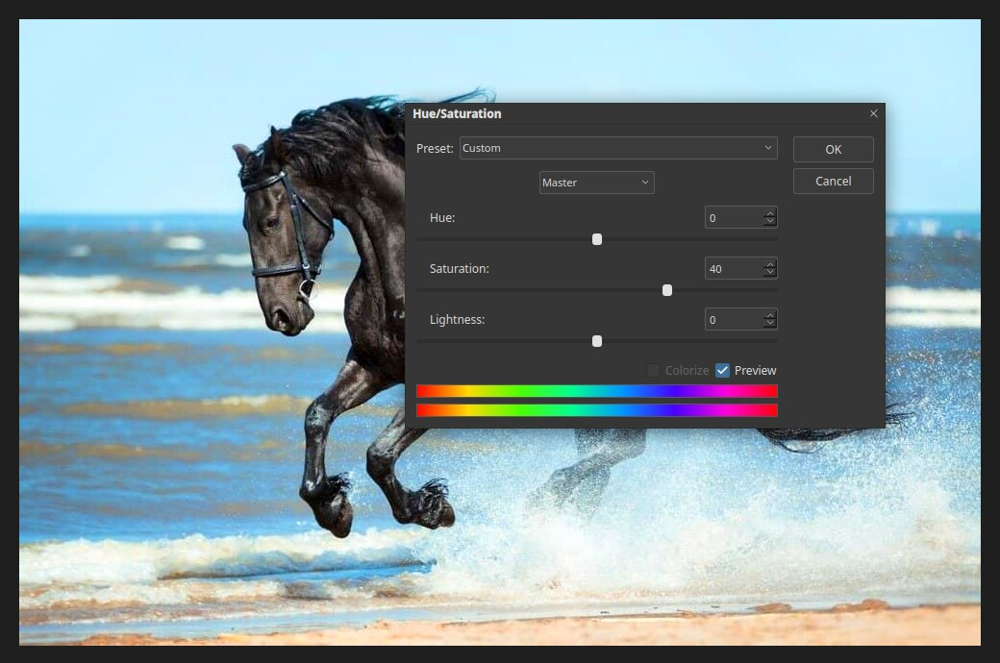

# Hue/Saturation

Hue/Saturation changes the colours of a picture. Open it with
**Image ▸ Adjustments ▸ Hue/Saturation…** or press `Ctrl+U`.

## The sliders

- **Hue** rotates every colour around the colour wheel. Red becomes orange, then yellow,
  and so on.
- **Saturation** is how strong the colours are. Move it right for vivid colours, and left
  for muted ones. At −100 the picture is grey.
- **Lightness** makes the picture lighter or darker.

The two colour bars at the bottom of the dialog show the effect: the top bar is the original
colours, the bottom bar is where each colour ends up.

## Working on one colour

The **Master** menu at the top changes all colours. Choose a single colour, such as
Blues, to change only that range. This is useful to deepen a sky without touching the
skin tones.

## Colorize

Tick **Colorize** to give the whole picture a single colour tint, controlled with the Hue
slider. It is useful for sepia and duotone looks.

## Tips

- Raise saturation a little at a time. A change of 10 to 30 is usually enough.
- Use [Vibrance](adjustments.md) instead if you want to protect colours that are already strong.
- Add it as an [adjustment layer](adjustment-layers.md) to keep it editable.
