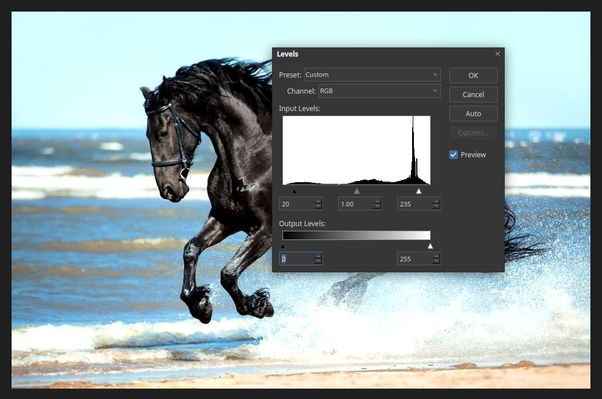

# Levels

Levels sets the darkest and lightest tones of a picture and the balance between them.
It is the quickest way to fix a dull, hazy or too-dark photo. Open it with
**Image ▸ Adjustments ▸ Levels…** or press `Ctrl+L`.

## Reading the dialog

- **Preset** and **Channel:** work on all colours together (RGB), or on one colour channel.
- **Input Levels:** the graph is a histogram, showing how many pixels are at each tone,
  dark at the left and light at the right. Three sliders sit under it: black point,
  midtone (gamma) and white point. The boxes below show their values.
- **Output Levels:** limit how dark or light the result can be. Most photos leave these alone.
- **Auto** sets the points for you. **Preview** shows the result live on the canvas.

## Using it

1. Look at the histogram. If it stops short of the left or right edge, the picture does
   not use the full range of tones.
2. Drag the **black point** slider to where the data starts. Everything left of it
   becomes pure black.
3. Drag the **white point** slider to where the data ends. Everything right of it
   becomes pure white.
4. Drag the middle slider left to lighten the midtones, right to darken them.
5. Click **OK**.

The photo above has its black point moved to 20 and its white point to 235, which adds
contrast. Pulling the points in too far loses detail in the shadows and highlights.

To keep the edit changeable, add Levels as an [adjustment layer](adjustment-layers.md).
