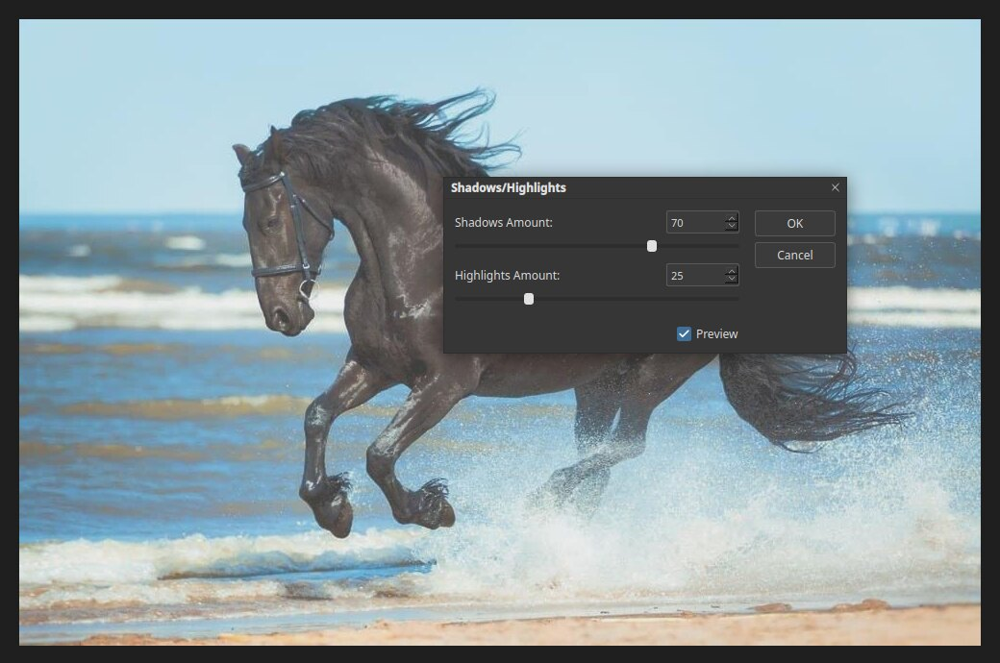

# Shadows/Highlights

Shadows/Highlights rescues detail from areas that are too dark or too bright, without
changing the rest of the picture. It suits backlit subjects and photos with a bright sky.
Open it with **Image ▸ Adjustments ▸ Shadows/Highlights…**.

## The sliders

- **Shadows Amount** lightens the dark areas. Higher values reveal more detail in the dark.
- **Highlights Amount** darkens the bright areas. Higher values recover more detail in the light.

In the example the dark horse is lifted with a shadows amount of 70, and the bright sea
spray is softened with a highlights amount of 25.

## Tips

- Raise shadows first, then highlights.
- Large values flatten the picture and can look unnatural. Stop when the detail returns.
- Brightening deep shadows brings out noise. Combine it with [Noise filters](filter-noise.md).
