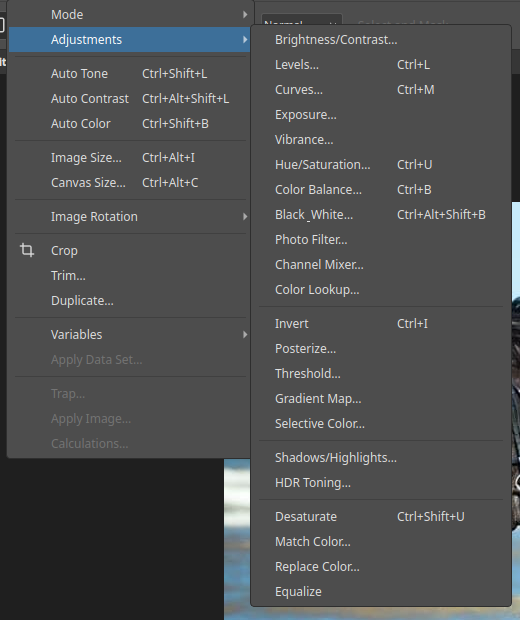

# Adjustments

Adjustments correct tone and colour. You can apply them two ways.

## As an adjustment layer (recommended)

See [Adjustment layers](adjustment-layers.md) for the full steps.

Click an icon in the **Adjustments** panel, or choose **Layer ▸ New Adjustment
Layer**. The correction sits on its own layer above the image. You can change it
later, lower its opacity, hide it, or limit it with its mask. The original
pixels stay untouched.

## Directly on a layer

The **Image ▸ Adjustments** menu applies the change to the selected layer
immediately. Each dialog has a live preview, and you can undo the result from the
History panel.

Common shortcuts: Levels `Ctrl+L`, Curves `Ctrl+M`, Hue/Saturation `Ctrl+U`,
Color Balance `Ctrl+B`, Invert `Ctrl+I`, Desaturate `Ctrl+Shift+U`.
**Auto Tone**, **Auto Contrast** and **Auto Color** on the Image menu give a one-click
correction.

## What is available

| Adjustment | Use it to |
|---|---|
| Brightness/Contrast | Make a quick tone change |
| Levels | Set black, white and midtone points. See [Levels](adjustments-levels.md) |
| Curves | Shape tone precisely along a curve. See [Curves](adjustments-curves.md) |
| Exposure | Fix an under- or over-exposed photo |
| Vibrance | Boost muted colours without clipping strong ones |
| Hue/Saturation | Shift colours or change their intensity. See [Hue/Saturation](adjustments-hue-saturation.md) |
| Color Balance | Add a colour cast to shadows, midtones or highlights |
| Black & White | Convert to monochrome with control over each colour. See [Black & White](adjustments-black-white.md) |
| Photo Filter | Warm or cool the image like a lens filter |
| Channel Mixer | Mix colour channels |
| Color Lookup | Apply a colour look |
| Invert | Flip every colour to its opposite |
| Selective Color | Change a colour range's makeup |
| Shadows/Highlights | Lift dark areas and recover bright ones. See [Shadows/Highlights](adjustments-shadows-highlights.md) |
| HDR Toning | Give a high-dynamic-range look |
| Gradient Map | Map tone to a colour gradient |
| Match Color | Match the colour of another image |
| Replace Color | Swap one colour for another |
| Equalize | Even out the tonal range |

## A good order

1. Fix the exposure with Levels, Curves or Exposure.
2. Correct the colour with Color Balance or Vibrance.
3. Finish with Hue/Saturation or Selective Color.

Check the **Histogram** panel as you work. It shows how the tones are spread and
whether highlights or shadows are clipping.
