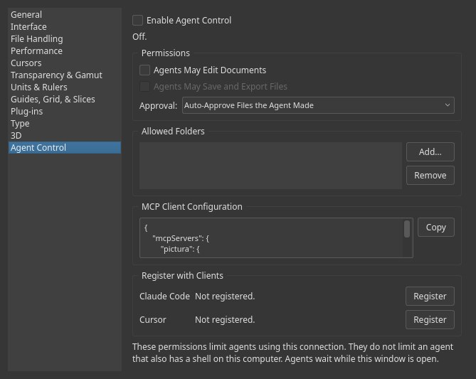

# Working with AI agents

Agent Control lets an AI agent work in Kooka Pictura for you. You can ask it to open a
photo, try a filter, fix the levels, and export the result. It connects through MCP
(Model Context Protocol), a standard way for AI tools to use other apps, so it works
with tools such as Claude Code and Cursor.

Agent Control is off until you turn it on, and an agent can only look at your work until
you allow more.



## Set it up

You need Kooka Pictura and an MCP client, the AI tool the agent runs in.

1. Open **Edit ▸ Preferences ▸ Agent Control**.
2. Tick **Enable Agent Control**. The status changes to **Listening**.
3. Tick what agents may do. **Permissions** below explains each one.
4. Under **Allowed Folders**, click **Add…** and choose the folders agents may use.
5. Under **Register with Clients**, click **Register** next to your client, and read the
   change it shows you before you accept.
6. Restart the client.
7. Close Preferences. Agents wait while it is open.

Then ask the agent something in your own words:

> Open ~/Pictures/beach.jpg in Pictura, brighten it a little, and export a PNG next to
> the original.

Keep Kooka Pictura open. The agent works in your window, so you can watch it, and each
step it takes appears in the History panel.

### Set up a client by hand

**Register** covers Claude Code, Cursor, and Claude Desktop on macOS and Windows. For any
other client, or if you prefer to do it yourself, click **Copy** under **MCP Client
Configuration** and paste the result into the client's MCP settings. It looks like this,
with the path to Kooka Pictura on your computer:

```json
{
  "mcpServers": {
    "pictura": {
      "command": "/path/to/pictura",
      "args": ["--mcp"]
    }
  }
}
```

In Claude Code you can run this instead:

```bash
claude mcp add --scope user pictura -- /path/to/pictura --mcp
```

To undo a registration, click **Unregister**. Before changing a client's settings file,
Kooka Pictura saves a copy beside it, with `.pictura-backup-` and the date in its name.

## What an agent can do

| Area | For example |
|---|---|
| Look | See the window, canvas or document, read pixels, and list layers and commands |
| Documents | Open, create, save, revert, close, and export a PNG |
| Filters | Any filter with a parameter list, with values it chooses |
| Adjustments | Levels, Hue/Saturation, Exposure and more, directly or as adjustment layers |
| Layers | Add, rename, reorder and restyle layers, and work inside groups |
| Selections | Rectangle, ellipse, lasso, Quick Selection and Magic Wand |
| Tools | Pick a tool, change its options, and use it on the canvas |
| Commands | Image Size, Canvas Size, rotate, fill, mode changes, flatten, and common menu commands |
| History | Undo, redo, jump to a state, and make and restore snapshots |

An agent cannot type with the keyboard or click outside the canvas, so it cannot enter
text with the Type tool or change settings. Commands that need a dialog are refused, and
an agent cannot choose the settings of a filter with its own special dialog, such as
Liquify or Displace.

## Permissions

| Setting | Lets an agent |
|---|---|
| Enable Agent Control | Look at your work, and open files |
| Agents May Edit Documents | Change documents, using everything above |
| Agents May Save and Export Files | Write files. This needs Edit too |

Changes apply at once, even while an agent is connected.

### Approval

When an agent wants a file it hasn't been cleared for, a bar appears at the top of the
window naming the file, with **Allow** and **Deny**. Allow turns on after half a second,
so a click meant for something else can't land on it. If nobody answers within a minute,
the agent is told no. The window keeps working while the bar is up.

**Approval** on the Agent Control page sets when the bar appears:

| Mode | Overwriting a file | Files outside Allowed Folders |
|---|---|---|
| Manual | Always asks | Always asks |
| Auto-Approve Files the Agent Made | Asks, unless the agent made that file or you approved it this session | Asks, with the same exception |
| Allow All | Never asks | Never asks |

Auto-Approve is the default. It lets an agent save the same file repeatedly without
asking each time. Allow All does not grant Edit or Save, but it does let an agent read and
overwrite any file you can, apart from the app's own settings.

## Your work stays yours

- An agent can't close or revert a document with unsaved changes. It is told to save
  first or leave it, and nothing is lost.
- Your own Close and Quit still ask about unsaved changes.
- Edits wait while you are busy: while a dialog or menu is open, a mouse button is held,
  a transform or crop is pending, or a document is loading.
- An agent can finish a crop it started, but not yours.
- If you switch documents, an agent that names the document it meant is stopped from
  changing the wrong one.
- Crash recovery stays on.

## Run a private instance

An agent can have its own hidden copy of Kooka Pictura instead of using your window. It
needs no open window or display, and it stops when the client does. This suits batch
jobs. Add `--spawn` to the client's arguments:

```json
"args": ["--mcp", "--spawn", "--tier", "save", "--root", "/home/me/Pictures"]
```

| Option | Means |
|---|---|
| `--spawn` | Start a private instance |
| `--tier read`, `edit` or `save` | What it may do. The default is `read` |
| `--root FOLDER` | A folder it may use. Repeat for more. The folder must exist |
| `--approval allow-all` | Never refuse a file, as Allow All does |

Nobody is there to answer a prompt, so a private instance refuses instead of asking. It
can't overwrite a file it didn't make, unless you use `--approval allow-all`.

## Staying safe

An agent reads what is in your files, including layer names and text, and a file can be
written to mislead it. These settings limit the damage:

- Give agents only the permissions a job needs.
- Keep **Allowed Folders** small, and leave Allow All off.
- Read the path in an approval bar before you click **Allow**.
- Keep backups of work that matters.

These permissions limit what an agent does through this connection. They **do not** limit
an agent that also has a shell on your computer, as many coding agents do. That kind of
agent can read and change files on its own, so control it with the client's own settings.

Agent Control stays on your computer. It uses a private local connection, not the
network. Your files go only where your client sends them, which for most clients includes
an AI service, so check how yours handles your work.

## Troubleshooting

| What you see | What to do |
|---|---|
| **Kooka Pictura is not running, or Agent Control is off** | Open the app, and tick **Enable Agent Control** |
| **Another Kooka Pictura window is serving agents.** | Only one window can serve agents. Close the other one, then untick and tick Enable |
| **Agent control is not available in this sandboxed build.** | Flatpak and Snap builds don't support it yet. Use another [install](installing.md) |
| The tool isn't listed in the client | Restart the client, and check that **Register** says **Registered.** |
| **Its command-line tool was not found.** | Claude Code isn't on the path the app can see. Use **Copy** and `claude mcp add` |
| **Its configuration is not plain JSON** | The file has comments or an error, so it was left alone. Add the entry by hand |
| `human_busy` | The agent is waiting for you. Close dialogs and Preferences, and finish any crop or transform |
| `unsaved` | Save or close the document yourself, or ask the agent to save it |
| `refused` | Agent Control doesn't allow this. Check the permissions and folders, or use the command yourself |
| `approval_timeout` | Nobody answered the bar. Ask the agent to try again |
| `stale_document` | The active document changed. Switch back, or tell the agent which one to use |
| `timeout` | The operation may still finish. Check the document before asking the agent to retry |

Agent Control is best tested on Linux. On a shared Windows computer, keep it off while
other people are signed in.
