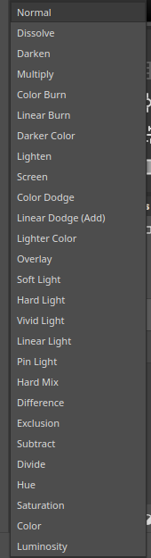
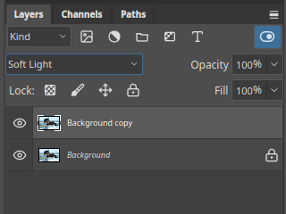

# Blend modes

A blend mode decides how a layer mixes with the layers below it. Choose it from the
menu at the top of the **Layers** panel. **Normal** simply covers what is beneath.

Kooka Pictura provides 27 layer modes, in groups:

| Group | Modes | Effect |
|---|---|---|
| Normal | Normal, Dissolve | Cover the layers below, or scatter pixels with Dissolve |
| Darken | Darken, Multiply, Color Burn, Linear Burn, Darker Color | Make the image darker |
| Lighten | Lighten, Screen, Color Dodge, Linear Dodge (Add), Lighter Color | Make the image lighter |
| Contrast | Overlay, Soft Light, Hard Light, Vivid Light, Linear Light, Pin Light, Hard Mix | Add contrast, lighter and darker at once |
| Compare | Difference, Exclusion, Subtract, Divide | Compare the layer with the ones below |
| Colour | Hue, Saturation, Color, Luminosity | Apply one part of the colour of the layer |

Groups have an extra mode, **Pass Through**, which lets the layers inside blend with
the layers outside the group.

## Try it

1. Duplicate a photo layer with **Layer ▸ Duplicate Layer…**.
2. Select the top layer and pick **Soft Light** in the blend mode list.

The photo gains contrast, because the layer is blended with a copy of itself.

## Tips

- **Multiply** darkens, and works well for shadows.
- **Screen** lightens, and works well for glows.
- **Overlay** and **Soft Light** add contrast; use them on a grey or colour layer.
- **Color** recolours a photo while keeping its light and dark detail.

## Opacity and fill

Next to the blend mode are **Opacity** and **Fill**. **Opacity** changes the whole
layer, including its effects. **Fill** changes the layer's pixels but keeps its
effects at full strength. See [Layer styles](layer-styles.md).

The **Lock** buttons beside them protect a layer's transparency, pixels or position.
