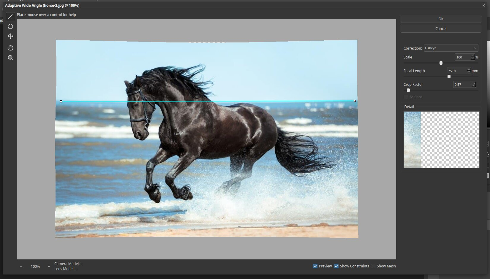
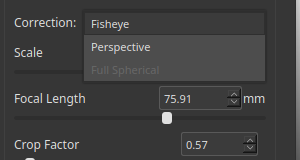

# Adaptive Wide Angle

Adaptive Wide Angle straightens the curved lines caused by wide-angle and fisheye lenses. Open it with
**Filter ▸ Adaptive Wide Angle…**.

## The window

- **Tools** at the left: Constraint, Polygon Constraint, Move, Hand and Zoom. Hover over a control to see help text
  at the top of the window.
- **Correction** chooses the lens model.

  

  **Fisheye** and **Perspective** are available. **Full Spherical** is listed but is not available for a normal photo.
- **Scale**, **Focal Length** and **Crop Factor** describe the lens.
- **Detail** shows a close-up of the area under the pointer.
- At the bottom, **Preview**, **Show Constraints** and **Show Mesh** turn overlays on and off.

## Using it

1. Pick the **Constraint** tool.
2. Drag a line along something that should be straight, such as the horizon. The line turns cyan.
3. The picture bends so that the line becomes straight. Add more constraints for other lines.
4. Adjust **Scale** to fill the corners, then click **OK**.

## Tips

- Use the Polygon Constraint for building outlines and other shapes with several straight edges.
- Fix a line by dragging its end points, or remove it by selecting it and pressing `Delete`.
- Work on a smart object to keep the correction editable.
