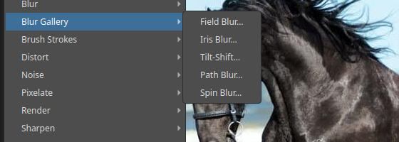
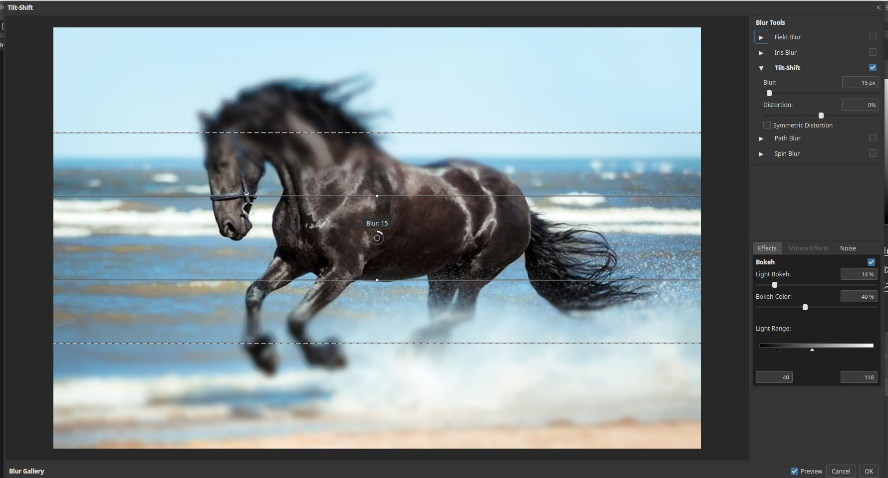

# Blur Gallery

The Blur Gallery gives you blurs you can place and shape right on the picture. They are
good for imitating the shallow depth of field of a large lens. Open the list with
**Filter ▸ Blur Gallery**.

| Filter | What it does |
|---|---|
| Field Blur… | Blurs by different amounts around pins you place |
| Iris Blur… | Keeps an oval area sharp and blurs the rest |
| Tilt-Shift… | Keeps a band sharp and blurs above and below it, like a miniature |
| Path Blur… | Blurs along a path, for a sense of motion |
| Spin Blur… | Blurs in a circle, like a spinning wheel |

## Tilt-Shift

Choose **Filter ▸ Blur Gallery ▸ Tilt-Shift…**.

On the picture you see a centre line and two outer dashed lines on each side.

- The area **between the solid lines** stays sharp.
- Between a solid and a dashed line the picture fades from sharp to blurred.
- Beyond the dashed lines the picture is fully blurred.

Drag the lines to move or resize them. The **Blur** value, here 15 px, is set in the
**Blur Tools** panel at the right. **Distortion** skews the blur.

## Effects

The **Effects** panel at the bottom right has **Bokeh**, to light up bright spots like
a camera lens does, along with **Motion Effects** and **Noise** tabs.

Click **OK** at the bottom right of the window to apply, or **Cancel**. Untick **Preview**
to compare with the original.

## Tips

- Combine several blurs: tick more than one filter in the **Blur Tools** list.
- Use it on a copy of the layer or a smart object so you can change it later.
