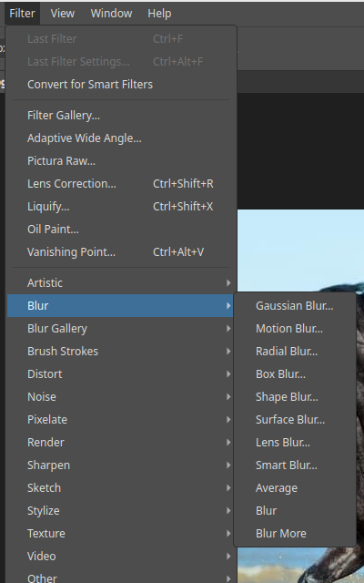
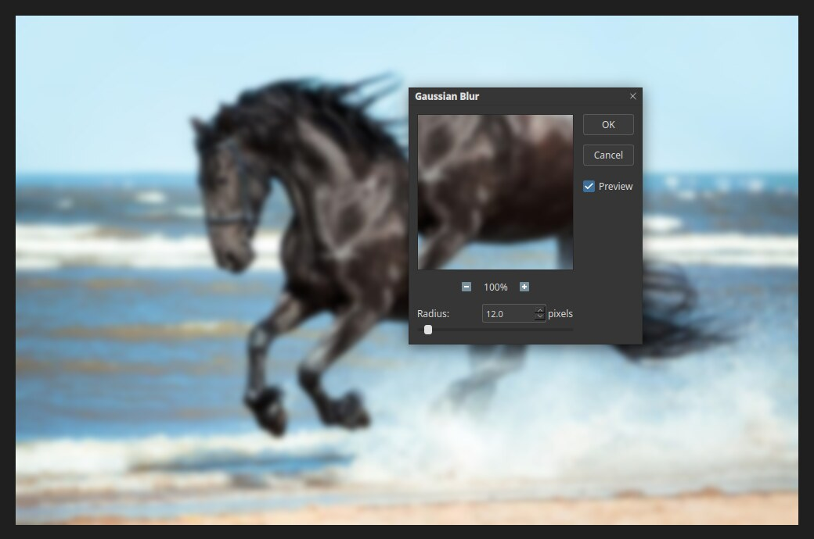

# Blur filters

Blur filters soften an image. Use them to hide small flaws, to smooth skin, to
create a sense of motion, or to push a background out of focus. Open the list with
**Filter ▸ Blur**.

| Filter | Best for |
|---|---|
| Gaussian Blur… | A smooth, even blur. The most common choice |
| Motion Blur… | The look of movement in one direction |
| Radial Blur… | Spin or zoom blur around a centre |
| Box Blur… | A fast, square-edged blur |
| Shape Blur… | A blur shaped like a chosen shape |
| Surface Blur… | Smooths flat areas while keeping edges |
| Lens Blur… | A camera-lens style out-of-focus blur |
| Smart Blur… | Blurs flat areas, and leaves edges alone |
| Average | Fills the layer or selection with its average colour |
| Blur, Blur More | One-click light and stronger blurs |

## Gaussian Blur

1. Select the layer, and optionally make a selection to blur only part of it.
2. Choose **Filter ▸ Blur ▸ Gaussian Blur…**.
3. Drag the **Radius** slider or type a value in pixels. A larger radius blurs more.
4. Click **OK**.

The photo above uses a 12 pixel radius. The small preview in the dialog shows a close-up.
Use the **−** and **+** buttons under it to change its zoom, and untick **Preview** to
compare with the original.

## Tips

- Blur a **copy** of the layer, or convert the layer to a [smart object](layers.md) first,
  so you can change the blur later.
- Add a [layer mask](layer-masks.md) to keep the subject sharp and blur only the
  background.
