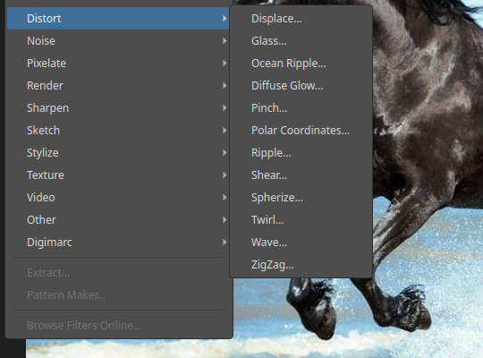
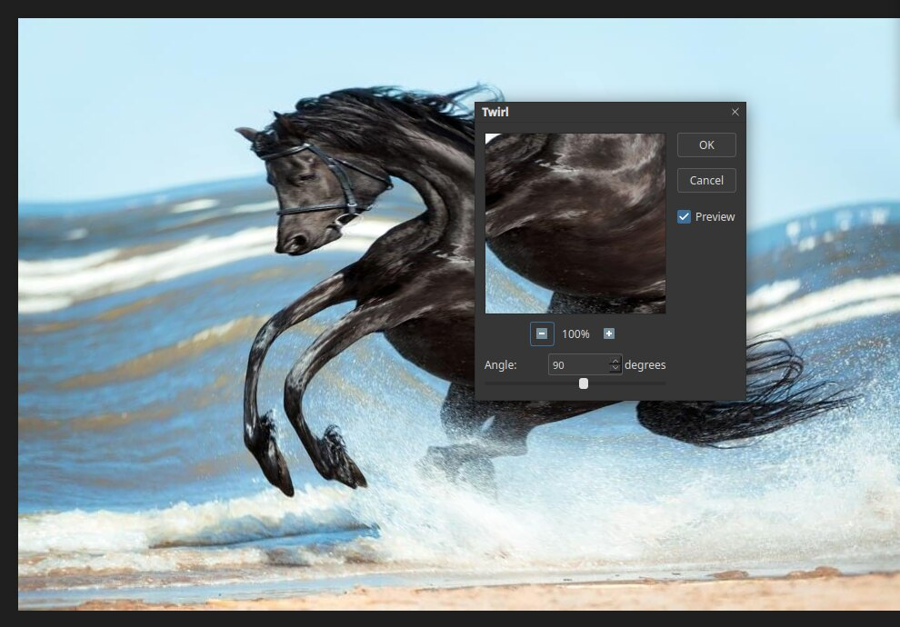

# Distort filters

Distort filters bend, twist and ripple the picture. Open the list with **Filter ▸ Distort**.

| Filter | What it does |
|---|---|
| Displace… | Moves pixels using another image as a map |
| Glass… | Looks through textured glass |
| Ocean Ripple… | Adds ripples like the surface of water |
| Diffuse Glow… | Adds a soft glow to light areas |
| Pinch… | Squeezes the picture toward or away from the centre |
| Polar Coordinates… | Wraps the picture into a circle, or unwraps it |
| Ripple… | Adds a gentle wave |
| Shear… | Bends the picture along a curve |
| Spherize… | Makes it bulge like a ball |
| Twirl… | Spins the centre of the picture |
| Wave… | Adds strong, adjustable waves |
| ZigZag… | Makes ripples that zig and zag from the centre |

## Twirl

Choose **Filter ▸ Distort ▸ Twirl…** and set the **Angle**. A positive angle spins the
picture clockwise and a negative angle spins it the other way.

The dialog shows a close-up preview. The **−** and **+** buttons below it change its zoom.

## Tips

- Make a selection first to distort only part of the picture.
- Distort a copy of the layer, or work on a [smart object](layers.md), to keep the
  original.
- To push pixels around by hand, use [Liquify](liquify.md) instead.
