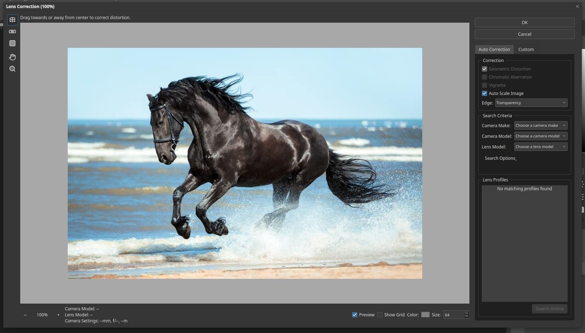
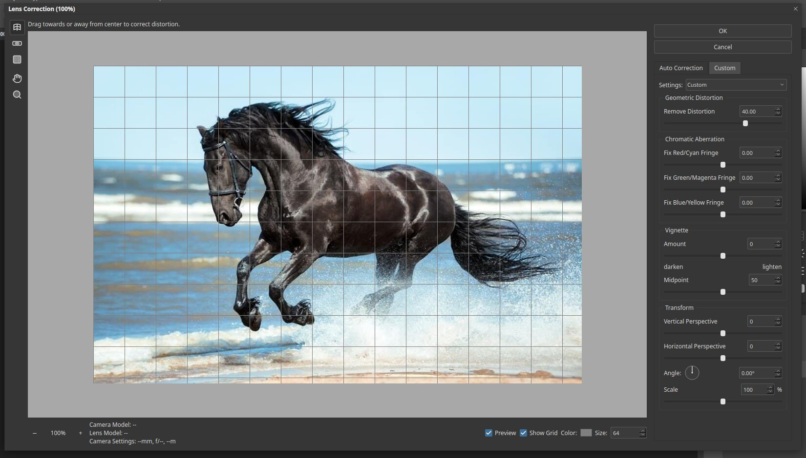

# Lens Correction

Lens Correction fixes the faults of camera lenses: curved lines, coloured edges, dark corners and tilted
perspective. Open it with **Filter ▸ Lens Correction…** or press `Ctrl+Shift+R`.

## Auto Correction

The first tab matches your photo to a lens profile.

- **Correction:** turn on **Geometric Distortion**, **Chromatic Aberration** and **Vignette**. They are only
  available once a profile is found.
- **Auto Scale Image** and **Edge:** how to fill the corners.
- **Search Criteria:** choose the **Camera Make**, **Camera Model** and **Lens Model**.
- **Lens Profiles** lists the matches. "No matching profiles found" means that none matched, as with this
  photo, which has no lens data.

## Custom

Use the Custom tab when there is no profile, or to correct by eye.

- **Remove Distortion** bends the picture to fix barrel or pincushion shapes.
- **Chromatic Aberration:** fix red/cyan, green/magenta and blue/yellow fringes.
- **Vignette:** **Amount** lightens or darkens the corners, and **Midpoint** sets how far it reaches.
- **Transform:** **Vertical Perspective**, **Horizontal Perspective**, **Angle** and **Scale**.

Tick **Show Grid** at the bottom to check that straight lines are straight.

## Tools

At the left: Remove Distortion, Straighten, Move Grid, Hand and Zoom.

## Tips

- Correct perspective on buildings with the two Perspective sliders and keep an eye on the grid.
- Use **Scale** to remove the empty edges left by the correction.
