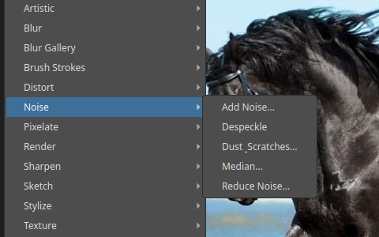
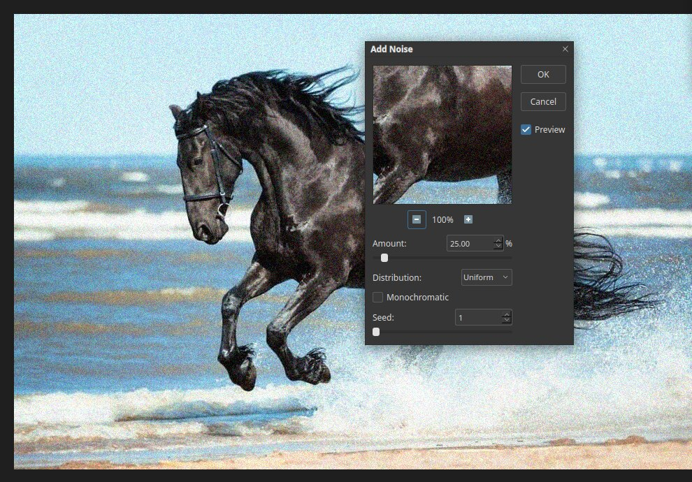

# Noise filters

Noise is the random grain in a picture. These filters add grain for a film look, or clean it
up. Open the list with **Filter ▸ Noise**.

| Filter | What it does |
|---|---|
| Add Noise… | Adds grain |
| Despeckle | Removes small specks while keeping edges |
| Dust & Scratches… | Hides dust and scratches by blurring small flaws |
| Median… | Reduces noise by averaging nearby pixels |
| Reduce Noise… | Removes noise with control over strength and detail |

## Add Noise

Choose **Filter ▸ Noise ▸ Add Noise…**.

- **Amount** is how strong the grain is. The picture above uses 25%.
- **Distribution** chooses **Uniform** or **Gaussian**. Gaussian gives a more natural look.
- **Monochromatic** adds grey grain, without colour speckles.
- **Seed** picks the random pattern. The same seed always gives the same result.

## Tips

- Add a small amount of noise to a smooth gradient or an over-blurred area, to hide banding.
- To clean a noisy photo, try **Reduce Noise…** first, and check the result at 100% zoom.
