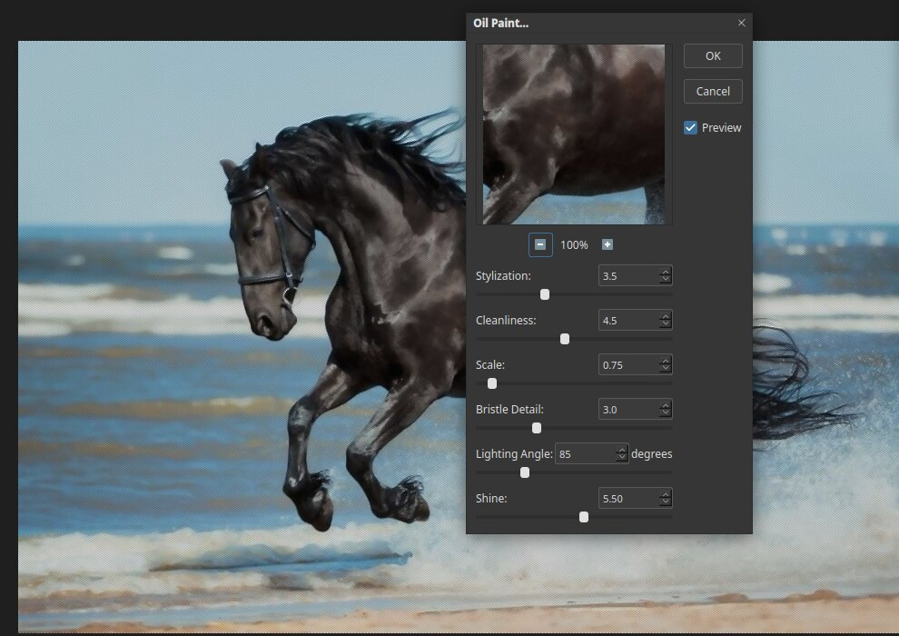

# Oil Paint

Oil Paint turns a photo into something that looks painted with thick brushstrokes. Open it
with **Filter ▸ Oil Paint…**.

## The controls

- **Stylization** is how much the brushstrokes flow and smear the picture.
- **Cleanliness** is how smooth and clean the strokes are. Low values leave rough,
  messy strokes.
- **Scale** is the size of the brush. Larger values make bigger strokes.
- **Bristle Detail** is how much detail shows in the bristle marks.
- **Lighting Angle** is the direction of the light that falls across the paint.
- **Shine** is how much the paint seems to catch the light.

## Tips

- Start with the defaults, then change **Scale** first.
- Detail disappears, so apply Oil Paint to a copy of the layer, and keep the original below.
- Check the effect at 100% zoom. The preview at the top of the dialog shows a close-up.
