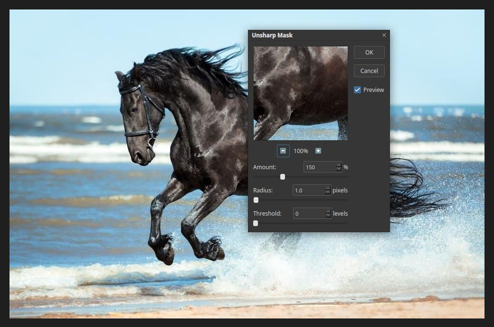

# Sharpen filters

Sharpening makes edges look crisper. It cannot restore detail that was never captured,
so use a light touch: too much sharpening creates bright halos along edges. Open the list with
**Filter ▸ Sharpen**.

| Filter | What it does |
|---|---|
| Smart Sharpen… | Sharpening with more control over shadows and highlights |
| Unsharp Mask… | The classic sharpening tool, with Amount, Radius and Threshold |
| Sharpen | One-click light sharpening |
| Sharpen Edges | Sharpens only the edges |
| Sharpen More | One-click stronger sharpening |

## Unsharp Mask

Choose **Filter ▸ Sharpen ▸ Unsharp Mask…**.

- **Amount** is how strong the sharpening is, as a percentage. The default is 150%.
- **Radius** is how wide the edge effect is, in pixels. Small values (0.5 to 2) suit most photos.
- **Threshold** is how different two neighbouring pixels must be before they are
  sharpened. Raise it to leave smooth areas, such as skin and sky, alone and avoid
  amplifying noise.

Watch the preview at 100% zoom, since sharpening is hard to judge when zoomed out. Click
**OK** to apply or **Cancel** to leave the layer alone.

## Tips

- Sharpen as the **last** step, after resizing and colour work.
- Sharpen only the subject by making a selection first.
- Apply the filter to a smart object to keep the sharpening editable.
