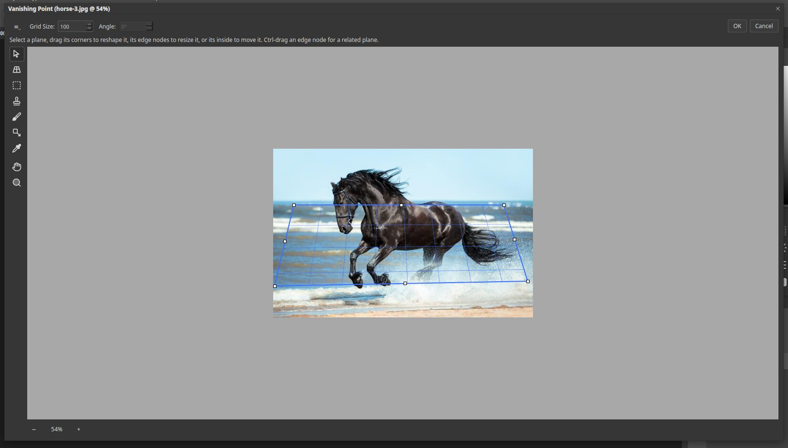

# Vanishing Point

Vanishing Point lets you edit a picture in perspective, so that things you paint, clone or paste follow the angle
of a wall, floor or road. Open it with **Filter ▸ Vanishing Point…** (`Ctrl+Alt+V`).

## Create a plane

1. The **Create Plane** tool is active when the window opens.
2. Click four corners of a surface to mark it. A blue grid appears over it.
3. Drag the corner handles to match the edges of the surface. The grid turns blue when it is valid.

The text at the top says: "Select a plane, drag its corners to reshape it, its edge nodes to resize it, or its
inside to move it. Ctrl-drag an edge node for a related plane."

## The tools

From the top: Edit Plane, Create Plane, Marquee, Stamp, Brush, Transform, Eyedropper, Hand and Zoom. **Grid Size**
and **Angle** are above the picture.

## Tips

- Zoom in with the **+** button for accuracy. The picture opens small when it is large.
- Draw planes on straight, regular surfaces such as tiles, fences or the side of a building.
- Hold `Ctrl` and drag an edge node to create a plane at right angles to the first.
- Click **OK** to apply your changes or **Cancel** to leave the picture alone.
