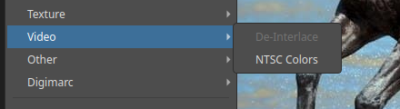
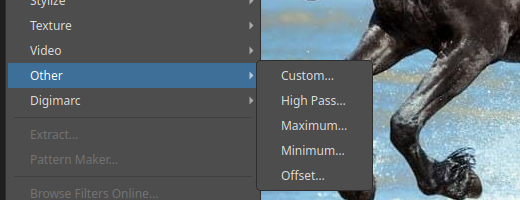
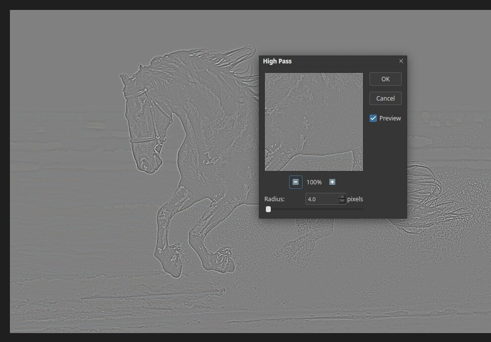
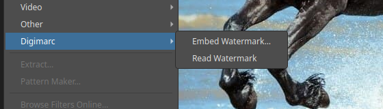
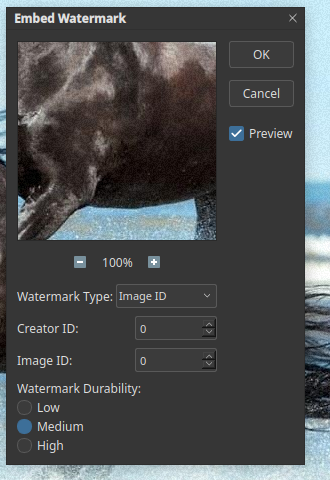

# Video, Other and Digimarc filters

## Video

- **De-Interlace…** removes the lines of one video field. Choose **Odd Fields** or **Even Fields** to say which field is thrown away, and **Interpolation** (a blend of the lines above and below) or **Duplication** (a copy of the line above) to say how the missing lines are rebuilt.
- **NTSC Colors** limits the colours to those a television can show. It runs at once, without a dialog.

## Other

| Filter | What it does |
|---|---|
| Custom… | Your own filter matrix |
| High Pass… | Keeps edges and removes smooth areas |
| Maximum… | Spreads light areas |
| Minimum… | Spreads dark areas |
| Offset… | Shifts the picture |

### High Pass

Choose **Filter ▸ Other ▸ High Pass…** and set a **Radius** in pixels. The picture turns grey with only the
edges showing.

A common use is sharpening: apply High Pass to a copy of the layer, cancel the grey with the
[Overlay or Soft Light blend mode](blend-modes.md), and the edges become crisper.

## Digimarc

Digimarc places an invisible watermark in the picture, and reads it back later.

**Embed Watermark…** has:

- **Watermark Type**, such as Image ID.
- **Creator ID** and **Image ID**.
- **Watermark Durability:** Low, Medium or High. Higher durability survives more editing but is more visible.

**Read Watermark** looks for a mark in the open picture.

The watermark is an approximation made for Pictura and is not compatible with Digimarc's own service.
