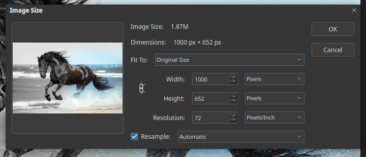

# Resizing an image

Choose **Image ▸ Image Size…** or press `Ctrl+Alt+I`.

The dialog shows:

- **Image Size** and **Dimensions:** the current size in memory and in pixels.
- **Fit To:** a preset. **Original Size** keeps the current size.
- **Width** and **Height:** the new size, in pixels or another unit. The chain icon
  between them keeps the proportions.
- **Resolution:** pixels per inch. This changes print size, not the number of pixels,
  when **Resample** is off.
- **Resample:** when on, pixels are added or removed to reach the new size. Leave the
  method on **Automatic** unless you have a reason to change it.

The small preview at the left shows how the whole picture looks.

## Canvas size

**Image ▸ Canvas Size…** (`Ctrl+Alt+C`) changes the area around the picture without
scaling it. Use it to add a border, or to cut away the edges.

## Other commands on the Image menu

- **Image Rotation** turns or flips the whole picture.
- **Crop** keeps only the selected area.
- **Trim…** removes transparent or same-colour edges.
- **Duplicate…** makes a copy of the document.
- **Mode** changes the colour mode, for example RGB to Grayscale.
- **Auto Tone** (`Ctrl+Shift+L`), **Auto Contrast** and **Auto Color** apply a quick
  automatic correction.
