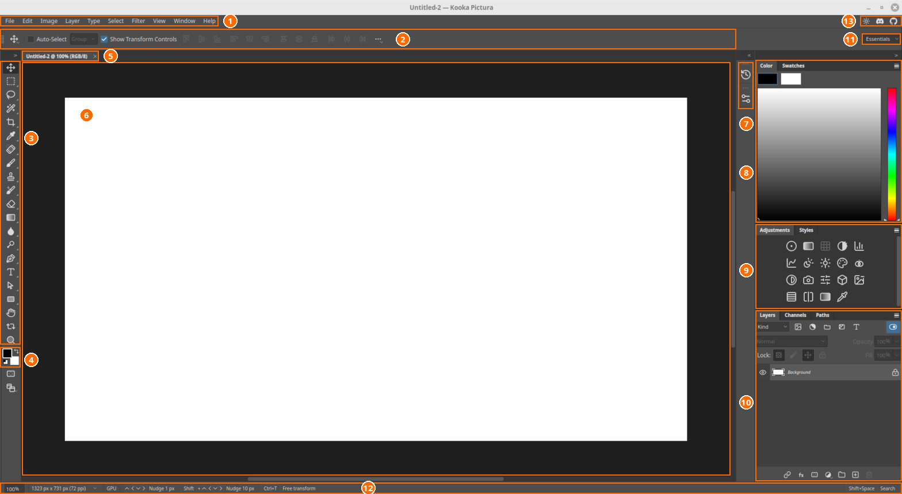

# A tour of the interface

Here is the main window. Each numbered area is described below.

## The areas of the window

1. **Menu bar.** Ten menus: File, Edit, Image, Layer, Type, Select, Filter, View, Window and Help.
2. **Options bar.** The settings for the active tool. With Move it shows Auto-Select, Show Transform Controls and the align buttons. Brush size or selection mode appear here for other tools.
3. **Toolbox.** The strip of tools. See "The toolbox" below.
4. **Foreground and background colour.** The two squares at the foot of the toolbox hold the colours used for painting and filling. Use the small arrows to swap or reset them.
5. **Document tab.** Each open file has a tab showing its name, zoom and colour mode. Switch between files with `Ctrl+Tab`.
6. **Canvas.** The picture you are editing. The dark area around it is the workspace.
7. **Collapsed panels.** Panels shrunk to icons, such as History and Properties. Click an icon to open the panel.
8. **Color and Swatches.** Pick a colour from the colour field and slider, or choose a saved swatch.
9. **Adjustments and Styles.** Click an icon in Adjustments to add an adjustment layer. Styles holds layer styles.
10. **Layers, Channels and Paths.** The Layers panel holds the layer stack, with a filter, blend mode, opacity, lock and fill controls. Buttons along the bottom link layers, add effects, add a mask, add an adjustment layer, group layers, add a new layer and delete one.
11. **Workspace switcher.** Choose a layout such as Essentials, Painting, Photography or Typography.
12. **Status bar.** Shows the zoom level, the image size and resolution, and the keyboard hints for the active tool. `Shift+Space` opens Search from here.
13. **Top-right icons.** A theme button and links to the project's Discord and GitHub pages.

## The menus

| Menu | What it holds |
|---|---|
| File | Open, save, export, print, file info |
| Edit | Undo, copy and paste, fill, stroke, transforms, preferences |
| Image | Mode, adjustments, image and canvas size, rotate, crop |
| Layer | New, mask, style, group, merge and smart object commands |
| Type | Text and font settings |
| Select | Select all, Color Range, modify and save selections |
| Filter | All filters, plus the Pictura Raw processor |
| View | Zoom, rulers, guides |
| Window | Panels, workspaces, window arrangement |
| Help | Search, system info, issue reporting |

## The toolbox

The toolbox includes Move, the selection tools (marquee, lasso, magic wand, quick selection), Crop, the retouching tools (spot healing, healing brush, patch, red eye, clone stamp), Brush, Eraser, Gradient and Paint Bucket, Blur, Sharpen and Smudge, Dodge, Burn and Sponge, the Pen and path tools, Type, Shapes, Hand and Zoom.

## More panels

Open any panel from the **Window** menu and drag it to rearrange. The main ones:

- **Layers:** the stack of layers, with masks and effects.
- **History:** every step you took; click one to go back.
- **Properties:** settings for the selected layer or mask.
- **Channels** and **Paths:** saved selections and pen paths.
- **Brush** and **Clone Source:** brush and cloning settings.
- **Histogram**, **Info** and **Navigator:** read tone, pixel values and the view.
- **Character** and **Paragraph:** text formatting.
- **Actions:** record and replay steps.

The Window menu also offers a UI size control.

## Documents

Each open file appears as a tab. Use `Ctrl+Tab` to switch between them. Drag a
tab out to make it a floating window.

## Find anything

Press `Shift+Space` to search every command, tool and panel by name. The result
shows where the command lives in the menus.
