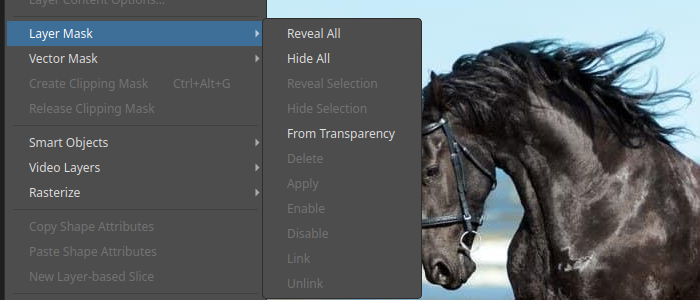
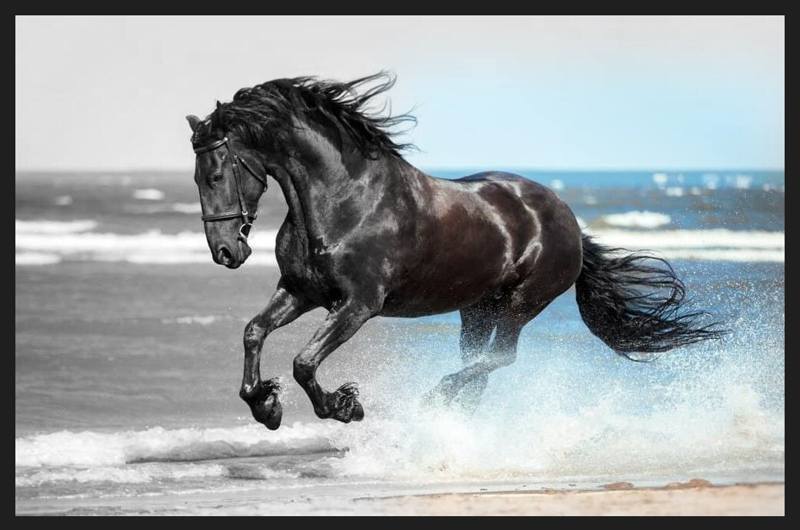
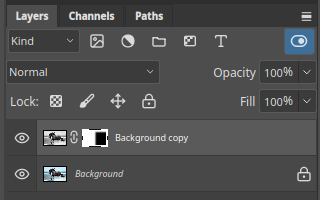

# Layer masks

A layer mask hides part of a layer without erasing it. White areas of the mask show
the layer, black areas hide it, and greys show it partly. Because nothing is deleted,
you can change your mind at any time.

## Add a mask

1. Select the layer in the **Layers** panel.
2. Click the **Add layer mask** button, third from the left on the row of buttons at
   the bottom of the panel, or use **Layer ▸ Layer Mask**.

A white mask appears next to the layer's thumbnail. A chain icon between the two
shows that the mask moves with the layer.

The **Layer ▸ Layer Mask** submenu offers more ways to make one:

- **Reveal All** adds a white mask that shows the whole layer.
- **Hide All** adds a black mask that hides the whole layer.
- **Reveal Selection** and **Hide Selection** build the mask from the current selection.
- **From Transparency** builds it from the layer's transparent areas.

## Paint on the mask

1. Click the mask thumbnail so the mask, not the layer, is active.
2. Paint with the Brush or fill a selection. **Black** hides the layer, **white**
   brings it back.

A soft brush gives a smooth fade. To fill a selection, use **Edit ▸ Fill…** and
choose the Foreground Color or Background Color.

## An example

This photo has two layers. The top layer is a black-and-white copy of the photo. On its
mask, a soft-edged rectangle on the right is filled with black, so the colour of the
layer underneath shows through there.

The Layers panel shows the black area on the mask thumbnail:

## Steps for this example

1. Open a photo, then use **Layer ▸ Duplicate Layer…** to copy it.
2. With the top layer selected, choose **Image ▸ Adjustments ▸ Desaturate**.
3. Click the mask button at the bottom of the Layers panel.
4. Select an area with the Rectangular Marquee tool and soften its edge with
   **Select ▸ Modify ▸ Feather…**.
5. Click the mask thumbnail, set black as the foreground colour, and choose
   **Edit ▸ Fill…**.
6. Press `Ctrl+D` to deselect.

## Turn a mask off or remove it

The **Layer ▸ Layer Mask** submenu also has **Disable** and **Enable**, **Apply**,
**Delete**, and **Link** and **Unlink**. Disabling keeps the mask for later, and
**Apply** merges it into the layer's pixels. **Link** and **Unlink** control whether the
mask moves with the layer.
