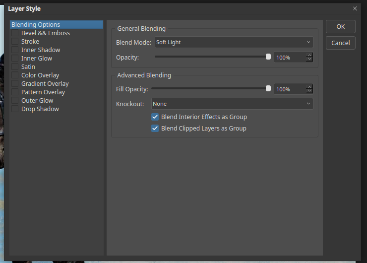
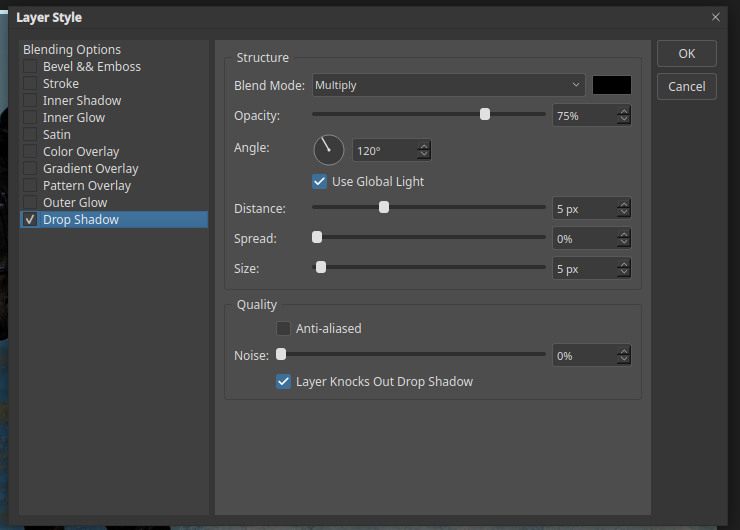

# Layer styles

Layer styles are live effects such as shadows and glows. They are not painted into
the pixels, so you can change or remove them later.

## Open the Layer Style dialog

Select a layer and click the **fx** button at the bottom of the Layers panel, or
choose **Layer ▸ Layer Style**.

The list on the left holds the styles. Tick a box to turn a style on, and click its
name to change its settings:

- Bevel & Emboss
- Stroke
- Inner Shadow and Inner Glow
- Satin
- Color Overlay, Gradient Overlay and Pattern Overlay
- Outer Glow
- Drop Shadow

## Blending Options

The first page, **Blending Options**, holds the layer's blending settings:

- **Blend Mode** and **Opacity** work as in the Layers panel.
- **Fill Opacity** fades the layer's pixels but not its effects.
- **Knockout** lets a layer punch through to the layers below.
- **Blend Interior Effects as Group** and **Blend Clipped Layers as Group** control how
  effects and clipped layers blend inside the layer.

## Example: Drop Shadow

Tick **Drop Shadow** to see its settings.

- **Blend Mode** and the colour swatch: Multiply with black by default.
- **Opacity:** how dark the shadow is.
- **Angle:** where the light comes from. **Use Global Light** keeps all styles
  consistent.
- **Distance:** how far the shadow is from the layer.
- **Spread** and **Size:** how hard or soft the edge is.
- **Noise** adds grain to the shadow.

Click **OK** to apply the style, or **Cancel** to leave the layer unchanged.

## Where styles appear

A layer with styles shows an **fx** icon. Open its **Effects** group in the Layers
panel to see each effect. Click the eye beside it to hide an effect, or use the
**Layer ▸ Layer Style** menu to copy a style to another layer or remove it.
