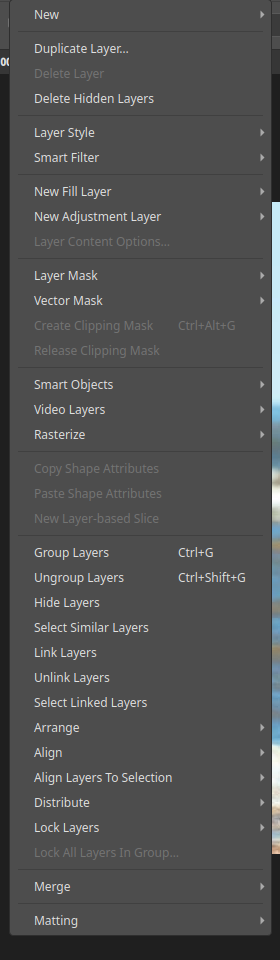

# Working with layers

Layers are transparent sheets stacked on top of each other. Edit one without
touching the rest, and reorder, hide or blend them at any time. Open the
**Layers** panel from the **Window** menu.

## The Layer menu

The **Layer** menu holds every layer command: new layers, duplicate and delete, styles,
masks, smart objects, grouping, arranging, aligning, locking and merging.

## Basics

- **New layer:** use **Layer ▸ New**, or the new-layer button on the Layers panel.
- **Duplicate:** use **Layer ▸ Duplicate Layer…**.
- **Select a layer:** click it in the panel. Edits apply to the selected layer.
- **Show or hide:** click the eye beside a layer.
- **Reorder:** drag a layer up or down.
- **Opacity:** lower the Opacity value to make a layer see-through.
- **Rename, delete and duplicate:** use the Layers panel or the **Layer** menu.

## Groups

Select several layers and choose **Layer ▸ Group Layers** to tidy them into a
folder. Groups can be nested, hidden together and given their own mask.

## Merge and flatten

**Layer ▸ Merge** combines layers into one. Flattening merges everything into a
single background layer. Keep a layered copy first if you may want to edit again;
exporting to JPEG or PNG flattens the result.

## Fill and adjustment layers

A **fill layer** holds a solid colour, gradient or pattern. An **adjustment
layer** applies a correction to everything beneath it without changing those
pixels. See [Adjustments](adjustments.md).

## Type and shape layers

The Type and Shape tools create their own layers. Text stays editable until you
turn it into pixels.

## Smart objects

**Layer ▸ Smart Objects ▸ Convert to Smart Object** wraps a layer so you can
transform it and apply filters without losing quality. Filters applied to a
smart object become **Smart Filters** that you can change or remove later.

## Locks and labels

Lock a layer to protect its pixels, transparency or position. Colour labels and
the layer filter help you find layers in a long stack.

## Align and distribute

With several layers selected, the **Align** and **Distribute** commands line them
up by their edges or centres.

## Layer masks

A mask hides or shows part of a layer without erasing it. See
[Layer masks](layer-masks.md) and [Selections and masking](selections-and-masking.md).

## Blend modes and styles

Each layer has a blend mode, an opacity and optional effects. See
[Blend modes](blend-modes.md) and [Layer styles](layer-styles.md).
