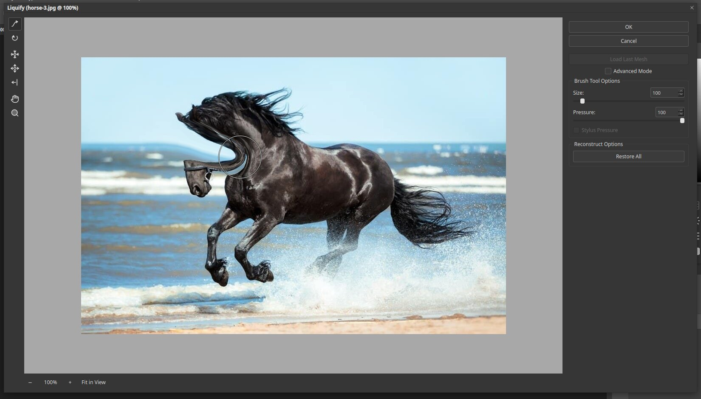

# Liquify

Liquify lets you push, pull, twirl and pinch parts of a picture as if it were wet paint.
It is often used for retouching, such as reshaping a smile or smoothing a curve. Open it with
**Filter ▸ Liquify…** or press `Ctrl+Shift+X`.

## The window

- **Tools** run down the left side, from the top: Forward Warp, Twirl Clockwise,
  Pucker, Bloat, Push Left, Hand and Zoom.
- **Brush Tool Options** at the right has **Size** and **Pressure**.
- **Reconstruct Options** has **Restore All** to undo every change in the dialog.
- At the bottom you can change the zoom or choose **Fit in View**.

## Using it

1. Pick the **Forward Warp** tool.
2. Set the **Size** to suit the area, and keep the **Pressure** lower for gentle changes.
3. Drag across the picture. Pixels move in the direction you drag.
4. Click **OK** to apply, or **Cancel** to leave the picture alone.

The circle on the picture is the brush. In the example above the mane was pushed with a
few short drags.

## Tips

- Make small changes. Large pushes look unnatural.
- Use a selection to protect areas you do not want to move.
- Press **Restore All** if you want to start again without closing the dialog.
