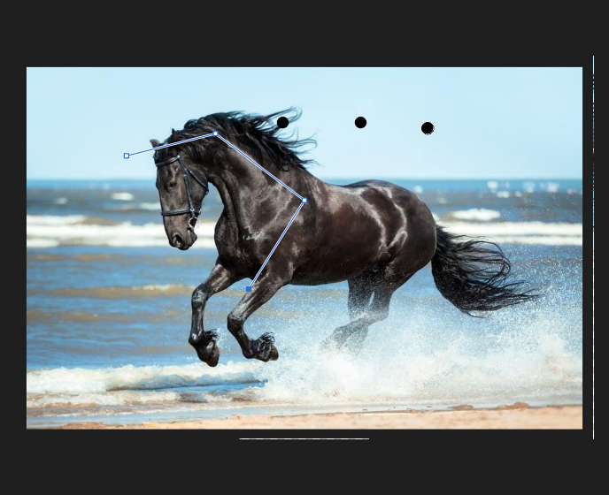
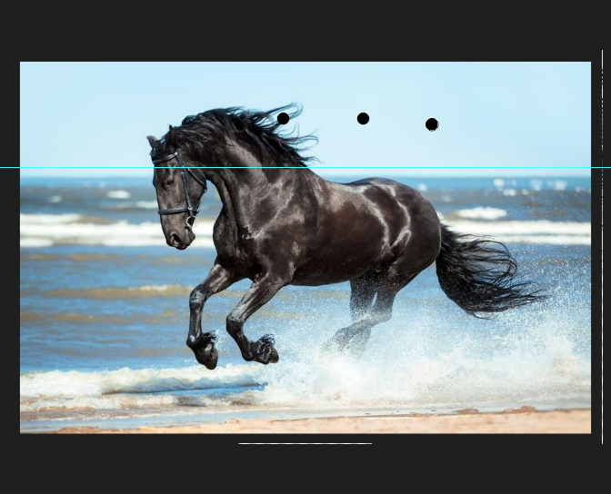
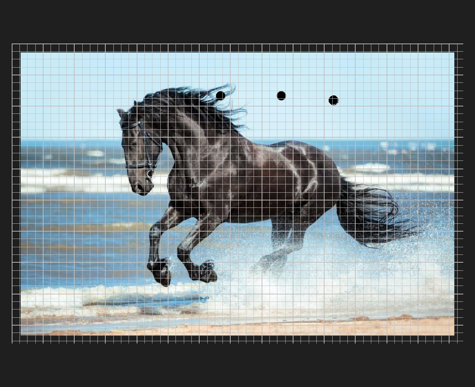
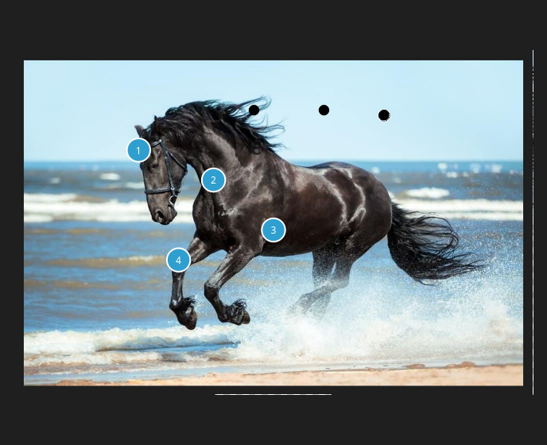
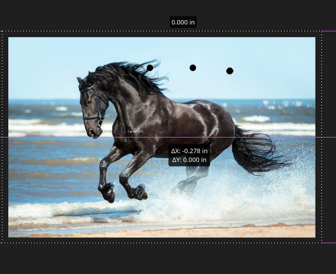
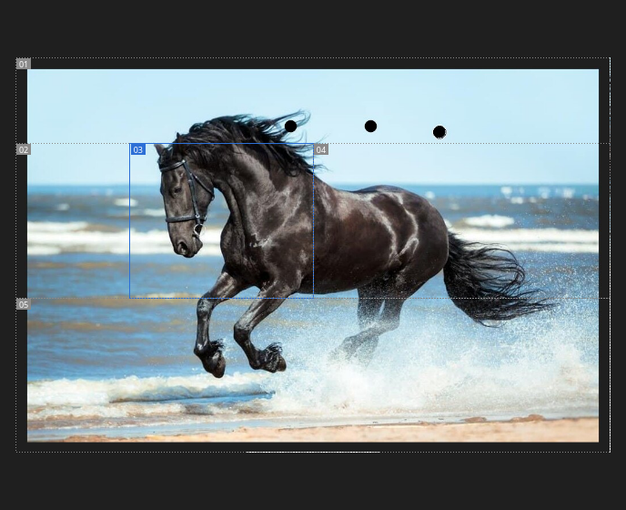
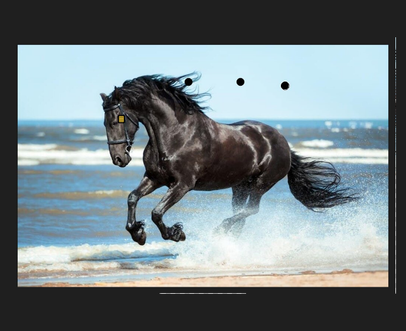
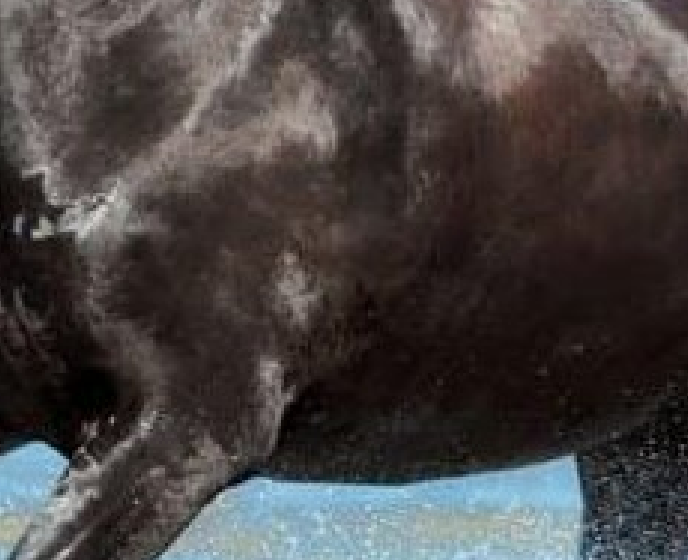

# The View menu

The View menu changes how the picture is displayed, not the picture itself:
proof colours, zoom, screen mode, rulers, guides, the Show extras and tool
hints. The Show extras are explained with screenshots below.

The screenshots below are captured from Kooka Pictura. They show the canvas with one extra switched on at a time.

## Proof Setup

**Proof Setup** chooses the output condition that **Proof Colors** simulates.
The custom setup opens a dialog; the working spaces use the document's
profiles.

| Command | Shortcut | What it does | More |
|---|---|---|---|
| Working CMYK | `—` | Uses the working CMYK space as the proof condition. |  |
| Working Gray | `—` | Uses the working grey space as the proof condition. |  |
| Custom | `—` | Opens the custom proof setup dialog. |  |

## Zoom, screen mode and guides

Zoom, screen mode, rulers, guides and the Show extras. The Show extras are
described in detail below.

| Command | Shortcut | What it does | More |
|---|---|---|---|
| Proof Colors | `Ctrl+Y` | Shows the picture through the proof setup. |  |
| Quick Mask Mode | `Q` | Edits the selection as a mask. | [Guide](selections-and-masking.md) |
| Zoom In | `Ctrl++` | Zooms in. |  |
| Zoom Out | `Ctrl+-` | Zooms out. |  |
| Fit On Screen | `Ctrl+0` | Fits the whole picture in the window. |  |
| 100% | `Ctrl+1` | Shows the picture at 100%. |  |
| 200% | `—` | Shows the picture at 200%. |  |
| Print Size | `—` | Shows the picture at its print size. |  |
| 32-Bit Preview Options… | `—` | Adjusts how a 32-bit RGB or grayscale document is displayed using Exposure and Gamma or Highlight Compression. The scene values stay intact. |  |
| Free Pan | `—` | Turns the current tool into a pan while held. |  |
| Snap Canvas To Workspace | `—` | Snaps the canvas to the workspace edge. |  |
| Rulers | `Ctrl+R` | Shows or hides the rulers. |  |
| Lock Guides | `Alt+Ctrl+;` | Prevents guides from being moved. |  |
| Clear Guides | `—` | Deletes every guide. |  |
| New Guide… | `—` | Adds a guide at a position you type. | [Guide](paths.md) |
| Lock Slices | `—` | Prevents slices from being moved. |  |
| Clear Slices | `—` | Deletes every user slice. |  |
| Extras | `Ctrl+H` | Hides or shows the extras chosen in Show Extra Options. |  |
| Tool Hints | `—` | Shows the active tool's shortcut hints. |  |

## Screen Mode

**Screen Mode** changes how much of the window the document fills. Standard
shows the normal window; the full-screen modes hide the desktop.

| Command | Shortcut | What it does | More |
|---|---|---|---|
| Standard Screen Mode | `—` | Returns to the normal window. |  |
| Full Screen Mode With Menu Bar | `—` | Fills the screen but keeps the menu bar. |  |
| Full Screen Mode | `—` | Fills the screen and hides the menu bar. |  |

## Show

**Show** turns the canvas overlays on and off. **All** and **None** change them
together; **Show Extra Options** chooses which ones **Extras** hides. The
individual extras are described with screenshots below.

| Command | Shortcut | What it does | More |
|---|---|---|---|
| Selection Edges | `—` | Shows the dashed outline of the selection. | [Guide](selections-and-masking.md) |
| Target Path | `—` | Shows the path the pen tool is working on. | [Guide](paths.md) |
| Layer Edges | `—` | Shows a box around the active layer's content. |  |
| Guides | `Ctrl+;` | Shows the guides. |  |
| Grid | `—` | Shows the grid. |  |
| Count | `—` | Shows the count markers. (Extended edition) |  |
| Smart Guides | `Ctrl+Shift+;` | Shows alignment guides while moving. |  |
| Slices | `—` | Shows the slices. |  |
| Notes | `—` | Shows the notes. |  |
| Pixel Grid | `—` | Shows the pixel grid at high zoom. |  |
| All | `—` | Turns every Show extra on. |  |
| None | `—` | Turns every Show extra off. |  |
| Show Extra Options | `—` | Chooses which extras the Extras command hides. |  |

## Not yet available

These commands appear in the menu but are greyed out for now. They are listed here so the menu is not a surprise.

- **View ▸ Proof Setup ▸ Color Blindness ▸ Protanopia-type**
- **View ▸ Proof Setup ▸ Color Blindness ▸ Deuteranopia-type**
- **View ▸ Gamut Warning**
- **View ▸ Snap**
- **View ▸ Snap To ▸ Guides**
- **View ▸ Snap To ▸ Grid**
- **View ▸ Snap To ▸ Layers**
- **View ▸ Snap To ▸ Slices**
- **View ▸ Snap To ▸ Document Bounds**
- **View ▸ Snap To ▸ All**
- **View ▸ Snap To ▸ None**
- **View ▸ Show ▸ 3D Axis** (Extended edition)

## The Show extras

Each extra is an overlay drawn on the canvas. The screenshots show one extra at a time on the same photo.

### Selection Edges

The dashed outline of the selection. It moves with the pixels and is the default way to see what is selected.

### Target Path

The path the pen tool is currently working on. A work path is temporary until you save it in the Paths panel.

### Layer Edges

A blue dashed box around the active layer's content. It shows the layer's extent even when the content is transparent, and it follows the active layer.

### Guides

The cyan guide lines. Drag from a ruler to add one, or use **View ▸ New Guide…**.

### Grid

The grid. Its spacing, colour and style are set in **Preferences ▸ Guides, Grid, & Slices**.

### Count

The numbered count markers. The Count tool adds them; this extra is only in the Extended edition.

### Smart Guides

Pink alignment lines that appear while you move a layer. They show when an edge or centre lines up with another layer, a guide or the canvas.

### Slices

The slice lines and numbers. The Slice tool draws them; **View ▸ Clear Slices** removes them.

### Notes

The note icons. The Note tool adds a note; click a note to read or edit it.

### Pixel Grid

A one-pixel grid that appears above 500% zoom, so you can see individual pixels.

<!-- pictura-commands
view.proof.setup.working.cmyk
view.proof.setup.working.gray
view.proof.setup.custom
view.proof.setup.color.blindness.protanopia.type
view.proof.setup.color.blindness.deuteranopia.type
view.proof.colors
view.gamut.warning
view.quickMask
view.zoomIn
view.zoomOut
view.fitOnScreen
view.actualPixels
view.200
view.print.size
view.hdr.preview
view.freePan
view.snapCanvasToWorkspace
view.screenMode.standard
view.screenMode.fullWithMenuBar
view.screenMode.full
view.rulers
view.snap
view.snap.to.guides
view.snap.to.grid
view.snap.to.layers
view.snap.to.slices
view.snap.to.document.bounds
view.snap.to.all
view.snap.to.none
view.lockGuides
view.clearGuides
view.newGuide
view.lock.slices
view.clear.slices
view.show.selectionEdges
view.show.target.path
view.show.layer.edges
view.show.3d.axis
view.show.guides
view.show.grid
view.show.count
view.show.smartGuides
view.show.slices
view.show.notes
view.show.pixel.grid
view.show.all
view.show.none
view.show.extraOptions
view.extras
view.toolHints
-->
