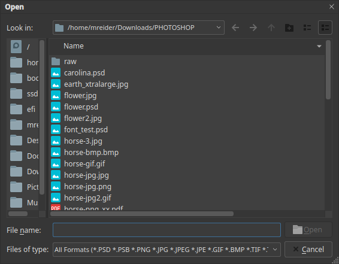
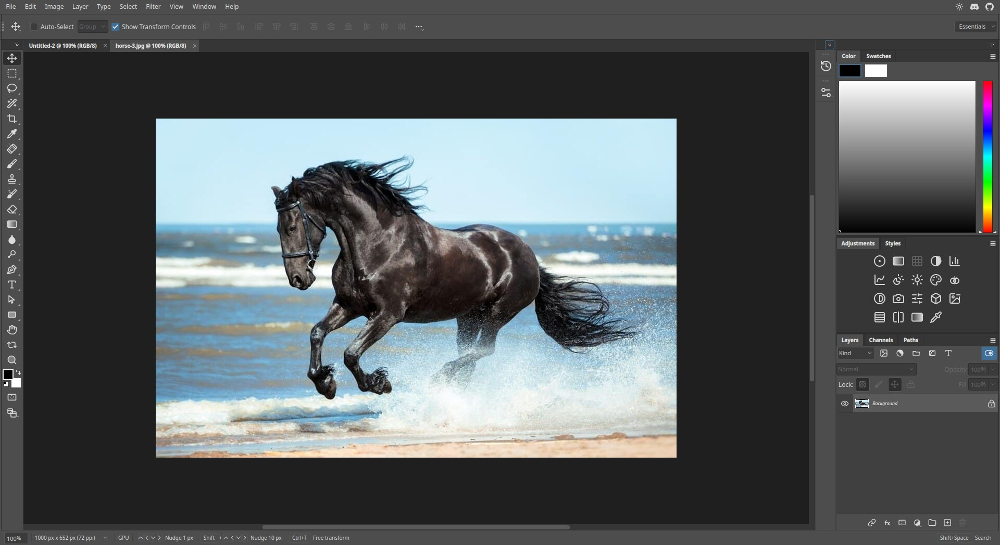

# Opening and saving files

## Opening a file

Choose **File ▸ Open…** or press `Ctrl+O`. The Open dialog lists the files in a
folder. Pick one and click **Open**, or type its path in the **File name** box.

The **Files of type** list defaults to every format Kooka Pictura can read. These
include PSD and PSB (Photoshop), PNG, JPEG, GIF, BMP, TIFF, WebP, PDF and EPS.

The file opens in a new tab at 100% zoom. The status bar at the bottom shows its
size in pixels and its resolution.

A JPEG or PNG opens as a single layer called **Background**. A PSD opens with all
of its layers, masks and effects.

## Several files at once

Every open file gets its own tab above the canvas. Click a tab to switch, or use
`Ctrl+Tab`. Drag a tab away from the bar to make it a floating window.

## Closing a file

Click the **×** on the tab. If the file has unsaved changes, Kooka Pictura asks
what to do:

- **Save** keeps your changes.
- **Discard** closes the file without saving. The original file on disk is not changed.
- **Cancel** returns to editing.

A star (*) after the name on the tab means the file has unsaved changes.

## Saving

**File ▸ Save** writes a PSD or PSB file and keeps the layers, masks, effects,
colour mode and bit depth. To get a flat picture for the web or for sharing, export
to PNG, JPEG, TIFF, WebP, BMP, GIF, SVG or PDF from the **File** menu. Exporting
flattens the layers, so keep a PSD copy if you want to edit later.
