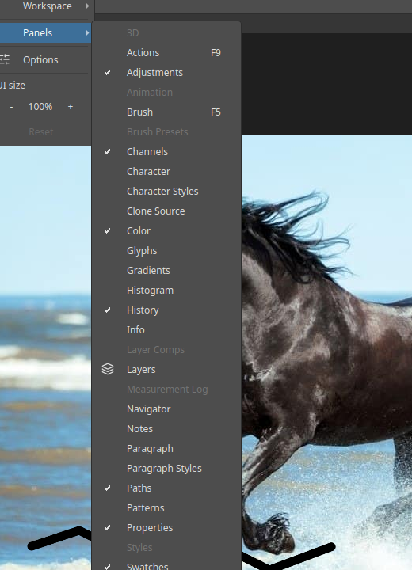

# Showing and hiding panels

Panels are the windows on the right of the main window, such as Layers and Color. You choose which
ones are visible.

## The Panels menu

Choose **Window ▸ Panels**.

A tick means the panel is open. Click a name to open or close it. A greyed name is not available yet.

The panels include Actions, Adjustments, Brush, Channels, Character, Character Styles, Clone Source,
Color, Glyphs, Gradients, Histogram, History, Info, Layers, Navigator, Notes, Paragraph, Paragraph
Styles, Paths, Patterns, Properties and more.

Some have a shortcut shown in the menu, such as `F9` for Actions and `F5` for Brush.

## Tips

- Drag a panel's tab to move it, or to group it with another panel.
- The **Window ▸ Workspace** menu offers Essentials, Painting, Photography and Typography layouts.
- Press `Tab` to hide all panels and the toolbox, for more room. Press it again to bring them back.
- **Window ▸ UI size** makes the whole interface larger or smaller.
