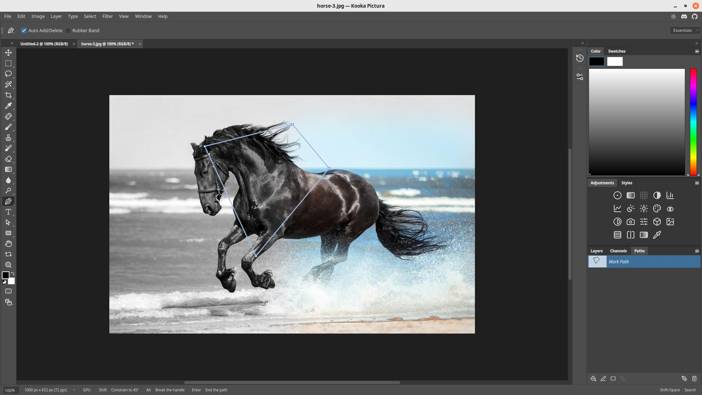

# Paths and the pen tool

A **path** is an outline made of points and smooth curves. It stays sharp at any
size, because it is not made of pixels. Use paths for precise selections, shapes
and cut-outs.

## Drawing with the Pen

1. Pick the **Pen** tool in the toolbox.
2. Click to place a point. Click again for a straight segment.
3. Click and drag to make a curved segment. The drag sets the curve.
4. Click the first point to close the path.

The **Freeform Pen** draws as you drag.

While you draw, the options bar offers **Auto Add/Delete** and **Rubber Band**, and the
status bar lists the shortcuts: hold `Shift` to constrain to 45°, hold `Alt` to break
the handle, and press `Enter` to end the path without closing it.

## Editing a path

- **Path Selection** moves a whole path.
- **Direct Selection** moves single points and handles.
- **Add, Delete and Convert Anchor Point** tools change the points.

## The Paths panel

Open **Window ▸ Paths** or click the **Paths** tab beside Layers. It lists your paths. A temporary **Work Path** is
replaced by the next one you draw; save it by renaming it to keep it.

From the panel you can:

- fill the path with colour, or stroke its outline;
- turn the path into a selection;
- turn a selection into a path;
- use the path as a vector mask on a layer.

## Shapes

The shape tools (rectangle, rounded rectangle, ellipse, polygon, line and custom
shape) draw ready-made paths. A shape becomes a shape layer with a fill and an
outline you can change.

## Text on a path

With the Type tool, click on a path to make text follow it.
