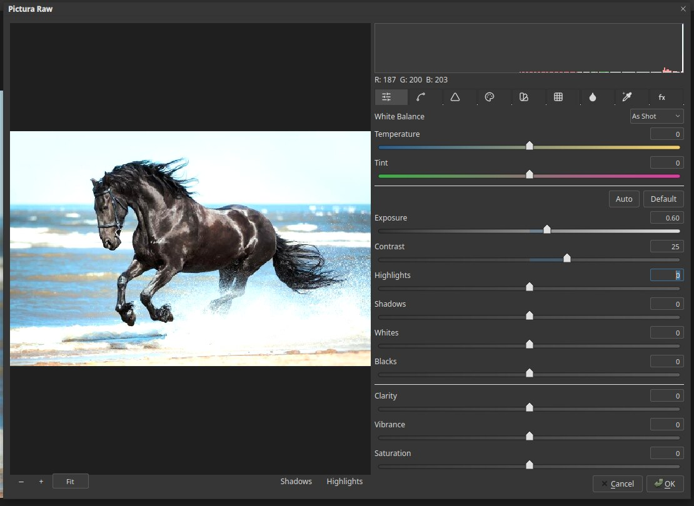
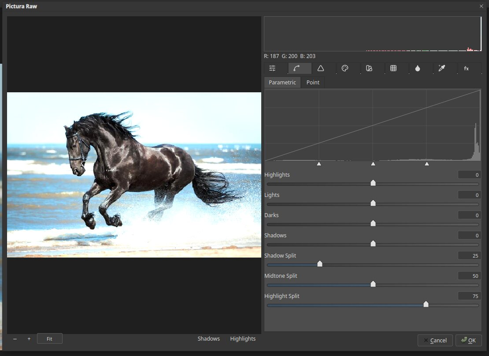
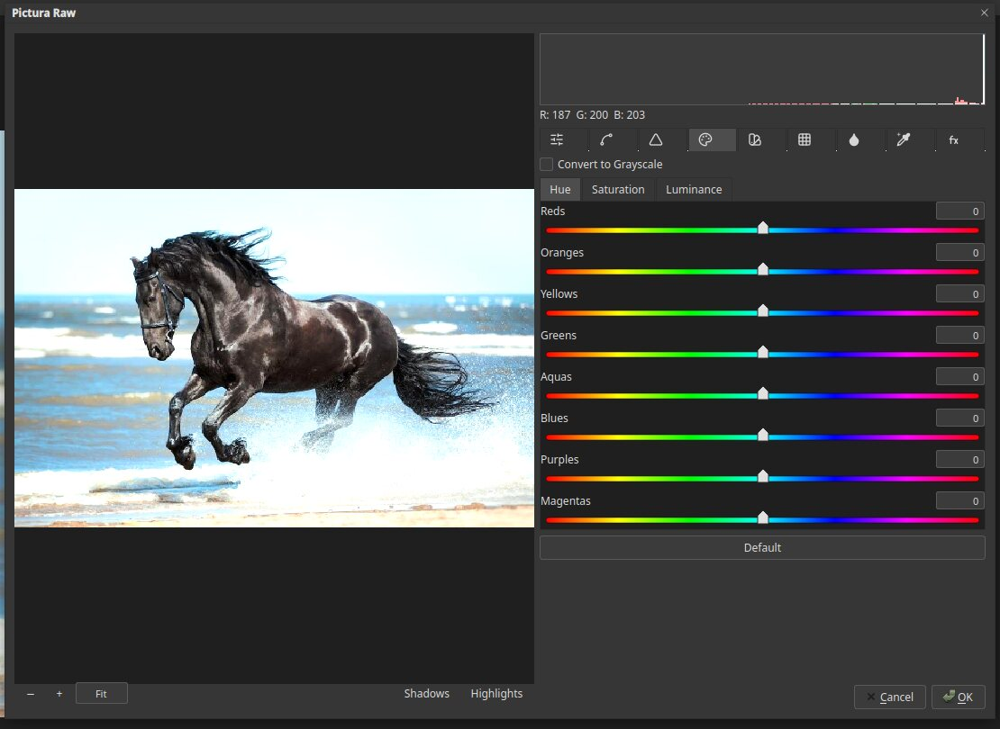
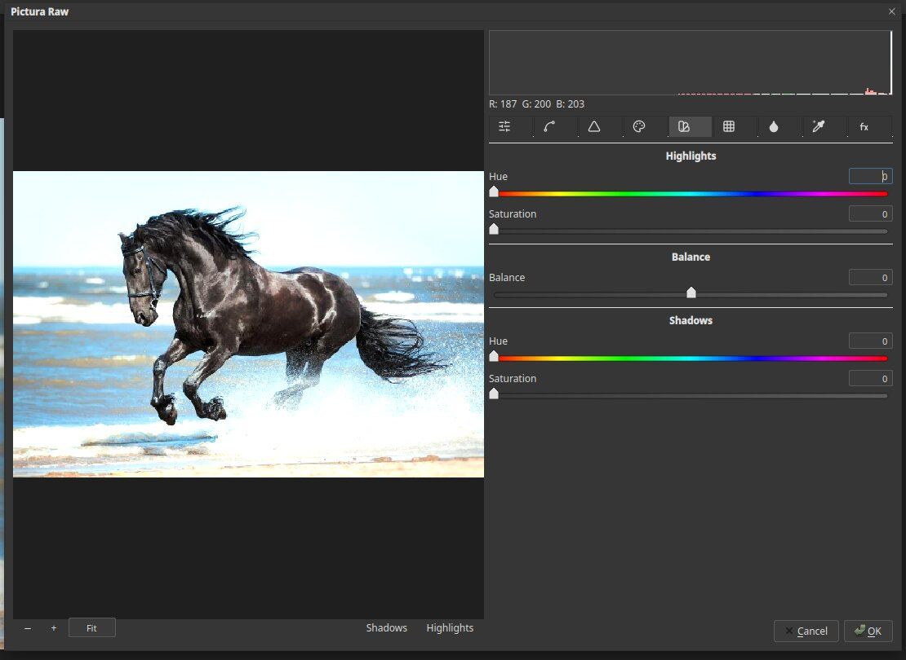
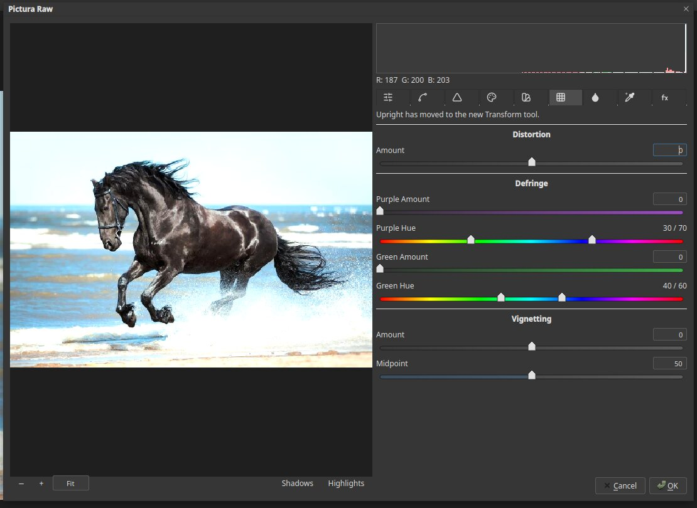
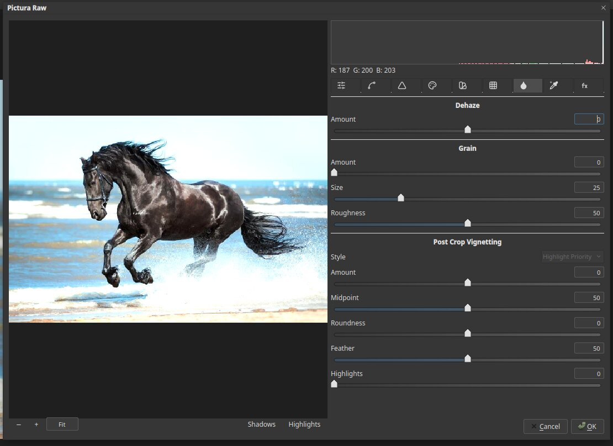
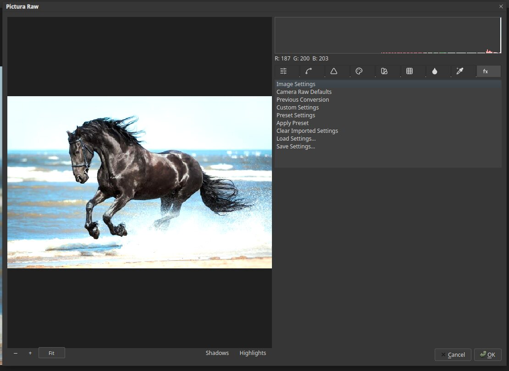

# Pictura Raw

Pictura Raw is the built-in photo developer. It edits tone, colour and detail in one window, with a
histogram that updates as you work. It opens in two ways: **File ▸ Open…** on a camera raw file
develops the file in Pictura Raw first, and **Filter ▸ Pictura Raw…** edits an image that is already open.

## Opening a raw file

Choose **File ▸ Open…** and pick a raw file (the **Camera Raw** file type lists DNG, CR2, CR3, NEF, ARW,
ORF, ORI, RW2, RWL and RAW). Pictura Raw opens with the photo at its as-shot white balance. Click **OK** to
open it as a 16-bit image. **Save Image…** in the same window writes a DNG copy instead.

A raw file only opens if Pictura has colour for its camera; see **Supported cameras** below.
Any other camera is refused, and the message names it. If your camera is missing, convert the file to
DNG with your camera maker's software or another converter: a DNG carries its own colour, so it opens
whatever camera took it.

## The window

The photo is at the left, with a **histogram** at the top right. Click **Fit** or the **−** and **+** buttons to
change the zoom. **Shadows** and **Highlights** at the bottom show where the picture is clipped. Click **OK** to
apply or **Cancel** to leave the picture alone.

Nine tabs run along the top of the controls.

## Basic

White balance (**Temperature** and **Tint**), then **Exposure**, **Contrast**, **Highlights**, **Shadows**, **Whites**,
**Blacks**, **Clarity**, **Vibrance** and **Saturation**. **Auto** sets a starting point, and **Default** resets it.

## Tone Curve

A curve with **Parametric** and **Point** pages. The parametric page has Highlights, Lights, Darks and
Shadows sliders and three split controls.

## Detail

**Sharpening** (Amount, Radius, Detail, Masking) and **Noise Reduction** (Luminance and Color, each with detail and
smoothness settings).

## HSL / Grayscale

Change the **Hue**, **Saturation** or **Luminance** of Reds, Oranges, Yellows, Greens, Aquas, Blues, Purples and
Magentas separately. Tick **Convert to Grayscale** for a mixer for black and white.

## Split Toning

Tints the **Highlights** and **Shadows** with different colours, with a **Balance** slider between them.

## Lens Corrections

**Distortion**, **Defringe** for purple and green fringes, and **Vignetting**. A note on the page says that Upright
has moved to the Transform tool.

## Effects

**Dehaze**, film **Grain**, and **Post Crop Vignetting** with its Amount, Midpoint, Roundness and Feather.

## Camera Calibration

Choose the **Process** version and camera profile, then adjust the primary colours (Red, Green and Blue Hue and
Saturation) and the **Shadows Tint**.

## Presets (the fx tab)

A list with **Image Settings**, **Camera Raw Defaults**, **Previous Conversion**, **Custom Settings**, **Preset Settings**,
**Apply Preset**, **Clear Imported Settings**, **Load Settings…** and **Save Settings…**.

## Supported cameras

**DNG** files open from any camera, because a DNG carries its own colour information. Other raw files
open from the cameras below. A camera marked * has approximate colour: it is matched to the camera's own
JPEGs, because no published sensor measurements exist for it. Names after a slash are the same camera
sold under another name.

### Canon (CR2 and CR3)

| Type | Cameras |
|---|---|
| EOS R mirrorless | EOS R, RP, R1\*, R3\*, R5, R5 C, R5 Mark II, R6, R6 Mark II, R6 Mark III\*, R7\*, R8, R10, R50, R50 V\*, R100\* |
| EOS DSLR | EOS-1Ds Mark II, 1Ds Mark III, 1D X Mark II, 1D X Mark III\*, 5D, 5D Mark II, 5D Mark III, 5D Mark IV, 5DS, 5DS R, 6D Mark II, 90D\*, 100D / Rebel SL1 / Kiss X7, 200D / Rebel SL2 / Kiss X9, 250D / 200D II / Rebel SL3 / Kiss X10, 400D / Rebel XTi / Kiss X, 850D\* / Rebel T8i / Kiss X10i |
| EOS M | EOS M, M50\* / Kiss M, M50 Mark II\* / Kiss M2, M6 Mark II\*, M200\* |
| PowerShot | G5 X Mark II\*, G7 X Mark III\*, S90, SX70 HS\*, V1\* |

### Nikon (NEF)

D70, D100\*, D200, D700, D800, D800E, D810, D850, D3300, D5100, D5300, D7000, D7100\*, Z 6II, Z f,
Coolpix P7100\*.

### Sony (ARW)

α7 III, α7 IV, α7C II, α7R II, α7R III, α7R IIIA, α7R IV, α7R IVA, α7R V, α7S II, α7S III, α9, α6400,
RX100 IV. Small and medium raws and the oldest ARW 1.0 files are not supported.

### Panasonic Lumix (RW2, RWL and RAW)

DC-GX9, DC-GH5S\*, DC-GH6\*, DC-S1\*, DC-S5\*, DMC-G1\*, DMC-GM1\* / GM1S, DMC-FZ18\*, DMC-FZ28\*,
DMC-ZS100\* / TZ100 / TZ101 / TZ110.

### Olympus and OM System (ORF and ORI)

Uncompressed ORF files from any camera, using the colour the camera records in the file. Compressed
ORF files (the usual setting) are not supported yet.

## Tips

- Start in Basic, then fine-tune in the other tabs.
- Watch the histogram. Spikes at either end mean lost detail.
- Pictura Raw is a Pictura feature. It plays the role of Adobe's Camera Raw but is not the same program.
