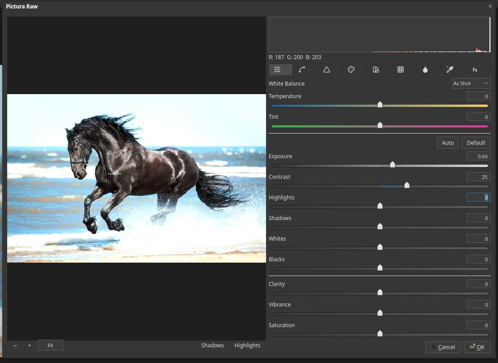
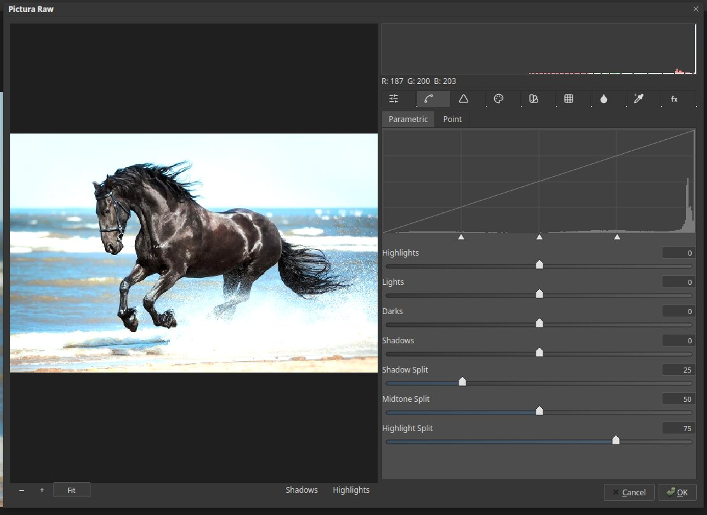
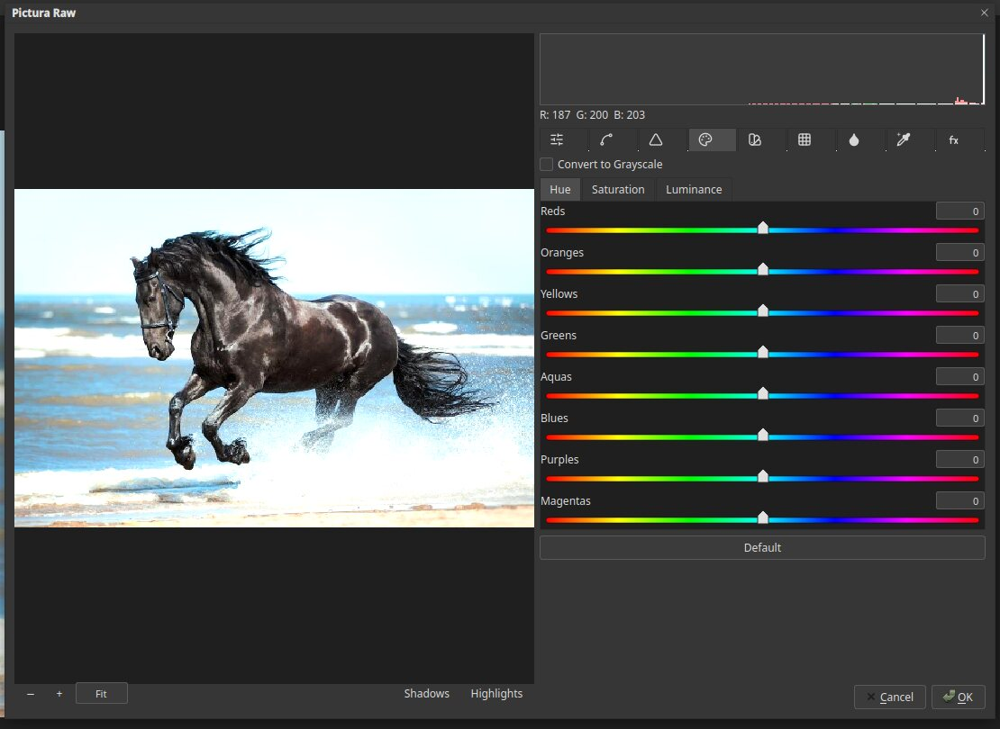
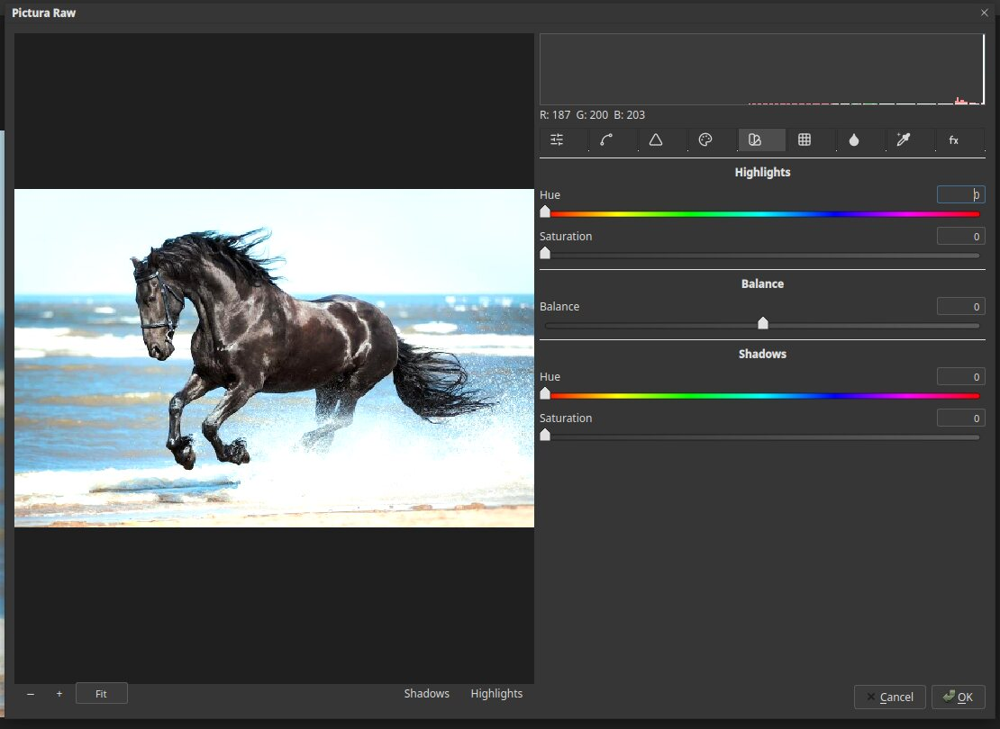
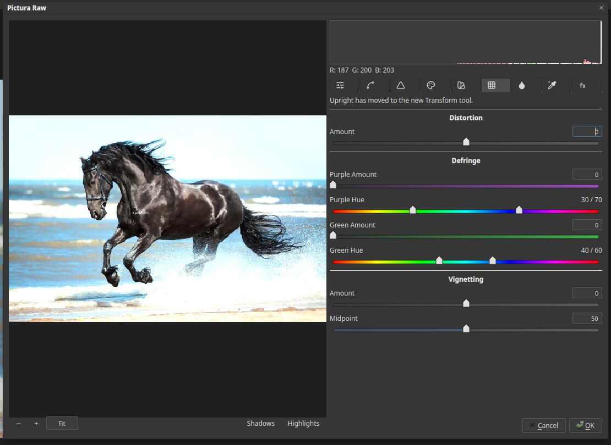
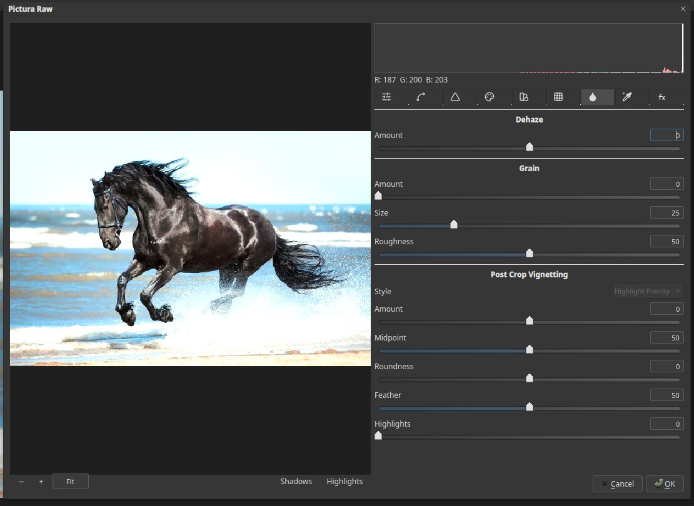
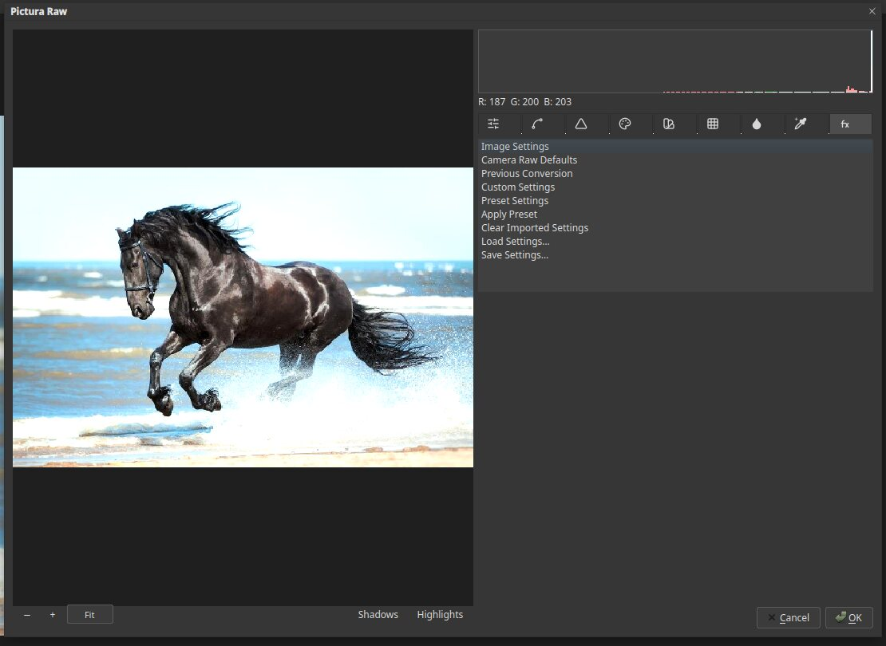

# Pictura Raw

Pictura Raw is the built-in photo developer. It edits tone, colour and detail in one window, with a
histogram that updates as you work. Open it with **Filter ▸ Pictura Raw…**. It works on an image that
is already open; opening a camera raw file directly is not supported yet.

## The window

The photo is at the left, with a **histogram** at the top right. Click **Fit** or the **−** and **+** buttons to
change the zoom. **Shadows** and **Highlights** at the bottom show where the picture is clipped. Click **OK** to
apply or **Cancel** to leave the picture alone.

Nine tabs run along the top of the controls.

## Basic

White balance (**Temperature** and **Tint**), then **Exposure**, **Contrast**, **Highlights**, **Shadows**, **Whites**,
**Blacks**, **Clarity**, **Vibrance** and **Saturation**. **Auto** sets a starting point, and **Default** resets it.

## Tone Curve

A curve with **Parametric** and **Point** pages. The parametric page has Highlights, Lights, Darks and
Shadows sliders and three split controls.

## Detail

**Sharpening** (Amount, Radius, Detail, Masking) and **Noise Reduction** (Luminance and Color, each with detail and
smoothness settings).

## HSL / Grayscale

Change the **Hue**, **Saturation** or **Luminance** of Reds, Oranges, Yellows, Greens, Aquas, Blues, Purples and
Magentas separately. Tick **Convert to Grayscale** for a mixer for black and white.

## Split Toning

Tints the **Highlights** and **Shadows** with different colours, with a **Balance** slider between them.

## Lens Corrections

**Distortion**, **Defringe** for purple and green fringes, and **Vignetting**. A note on the page says that Upright
has moved to the Transform tool.

## Effects

**Dehaze**, film **Grain**, and **Post Crop Vignetting** with its Amount, Midpoint, Roundness and Feather.

## Camera Calibration

Choose the **Process** version and camera profile, then adjust the primary colours (Red, Green and Blue Hue and
Saturation) and the **Shadows Tint**.

## Presets (the fx tab)

A list with **Image Settings**, **Camera Raw Defaults**, **Previous Conversion**, **Custom Settings**, **Preset Settings**,
**Apply Preset**, **Clear Imported Settings**, **Load Settings…** and **Save Settings…**.

## Tips

- Start in Basic, then fine-tune in the other tabs.
- Watch the histogram. Spikes at either end mean lost detail.
- Pictura Raw is a Pictura feature. It plays the role of Adobe's Camera Raw but is not the same program.
