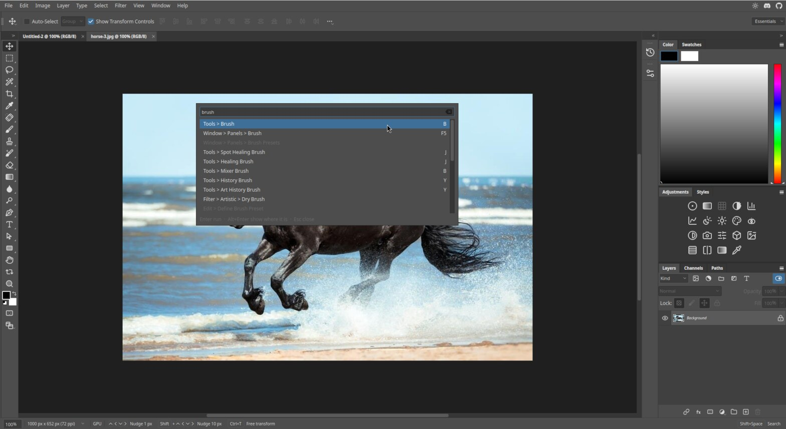

# Search

Search finds any command, tool, panel or preference by name. If you cannot remember which menu something is in,
use Search. Press `Shift+Space`, or click **Search** at the right of the status bar.

## Using it

1. Press `Shift+Space`. A box opens over the canvas.
2. Start typing. Results appear as you type, with the place each one lives, for example **Tools ▸ Brush**.
   Its shortcut, if it has one, is on the right (`B`).
3. Use the arrow keys to move through the list.
4. Press `Enter` to run the highlighted item. Press `Alt+Enter` to show where it lives in the menus instead.
5. Press `Esc` to close the box.

Items that cannot be used right now, such as **Edit ▸ Define Brush Preset** without a selection, are shown greyed out.

## What it finds

Commands from every menu, tools, panels (for example **Window ▸ Panels ▸ Brush**, `F5`), filters
(**Filter ▸ Artistic ▸ Dry Brush**), preference pages and key panel controls.

## Tips

- Type part of a name. "brush" finds all of the brush tools and panels.
- Use Search to learn shortcuts: the key is shown beside the result.
