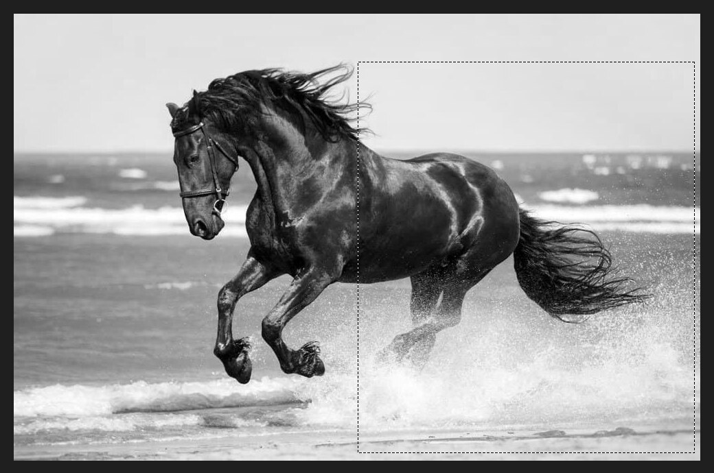
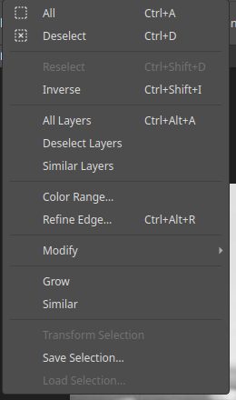
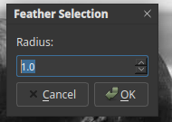

# Selections and masking

A **selection** limits an edit to part of the image. A **mask** hides part of a
layer without deleting it.

## Making a selection

| Tool | Use it for |
|---|---|
| Rectangular and Elliptical Marquee | Boxes and ovals |
| Lasso, Polygonal Lasso | Freehand and straight-edged shapes |
| Magnetic Lasso | Following a visible edge |
| Magic Wand | Selecting an area of similar colour |
| Quick Selection | Painting over an object to select it |

The moving dashes ("marching ants") show the selection edge.

While the Marquee tool is active, the options bar shows buttons to start a new
selection, add to one, subtract from one or intersect with one. You can also hold
`Shift` to add or `Alt` to subtract; the status bar reminds you. **Feather** softens the
edge as you draw, and **Select and Mask…** opens the edge refinement tools.

## The Select menu

- **All** (`Ctrl+A`), **Deselect** (`Ctrl+D`), **Reselect** (`Ctrl+Shift+D`) and
  **Inverse** (`Ctrl+Shift+I`).
- **All Layers**, **Deselect Layers** and **Similar Layers** choose layers, not pixels.
- **Color Range…** and **Refine Edge…** (`Ctrl+Alt+R`).
- **Modify**, **Grow**, **Similar**, **Transform Selection**.
- **Save Selection…** and **Load Selection…**.

## Improving a selection

- **Select ▸ Modify:** Border, Smooth, Expand, Contract and Feather (`Shift+F6`).
  Feather asks for a radius in pixels and blurs the edge so the change fades in.

  
- **Refine Edge:** softens, smooths and cleans the edge, such as around hair. You
  can send the result to a layer mask.
- **Color Range:** selects everything of a chosen colour.
- **Save and load:** keep a selection in a channel and bring it back later.

## Layer masks

A mask is a greyscale picture attached to a layer:

- **White** shows the layer.
- **Black** hides it.
- **Grey** shows it partly.

To add one, select the layer and choose **Layer ▸ Layer Mask ▸ Reveal All**, which
shows everything, or **Hide All**, which hides everything. With a selection active,
use **Reveal Selection** or **Hide Selection**.

To edit the mask, select it in the Layers panel and paint on the canvas with the
Brush. Black hides, white reveals, and a soft brush gives a smooth fade.

## Clipping masks

A **clipping mask** limits a layer to the shape of the layer below it. It is
handy for putting a photo inside text or a shape.

## Vector masks

A vector mask hides part of a layer using a path drawn with the Pen or Shape
tools. See [Paths and the pen tool](paths.md).

## Adjustments through masks

Every adjustment layer has a mask. Paint black on it to keep a correction away
from part of the picture, such as brightening a face but not the background.
