# Text and the Typography workspace

Text in Kooka Pictura lives on its own layer, so you can change it at any time.

## The Typography workspace

Choose **Typography** from the workspace menu at the top right of the window. It opens the panels used for text:
**Character** and **Paragraph**, and below them **Paragraph Styles**, **Character Styles** and **Glyphs**.

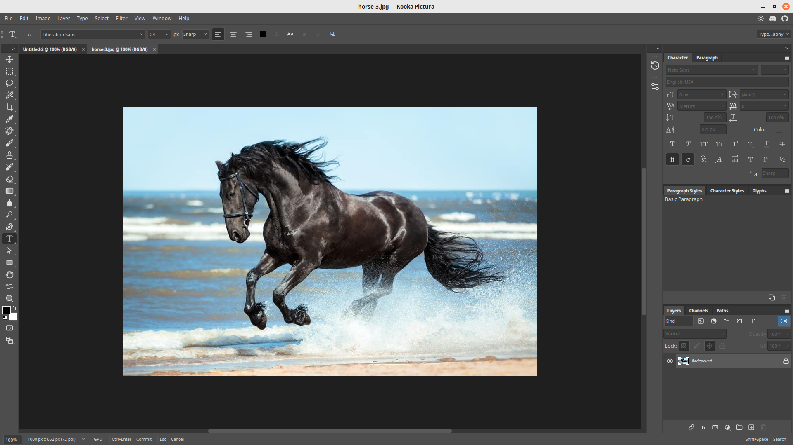

## Adding text

1. Pick the **Type** tool (`T`) in the toolbox.
2. Click on the picture where the text should start, and type.
3. Press `Ctrl+Enter` to finish, or `Esc` to cancel. The text becomes a new layer named after its content.

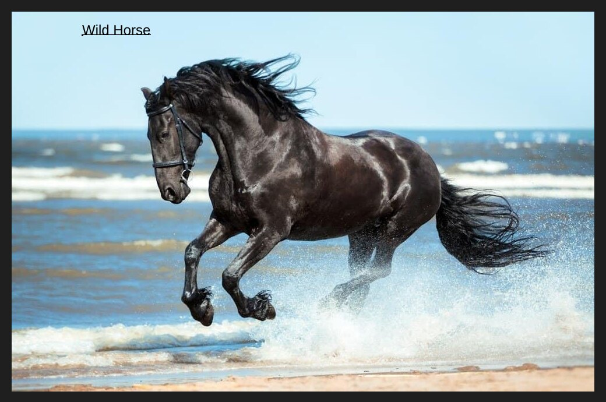

The options bar shows the font, size, anti-aliasing, alignment and colour.

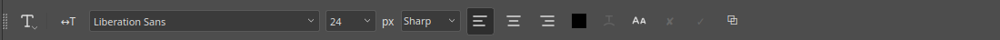

## Choosing a font and style

Select the text you want to change, by dragging over it or pressing `Ctrl+A` for all of it. Then use the
**Character** panel or the options bar.

- The **font family** list shows each font with a preview of the word "Sample".

  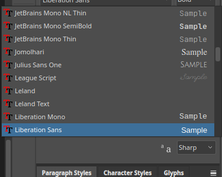

- The **style** list beside it picks Regular, Italic, Bold or Bold Italic, when the font offers them.

  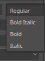

Here is the same text in a script font:

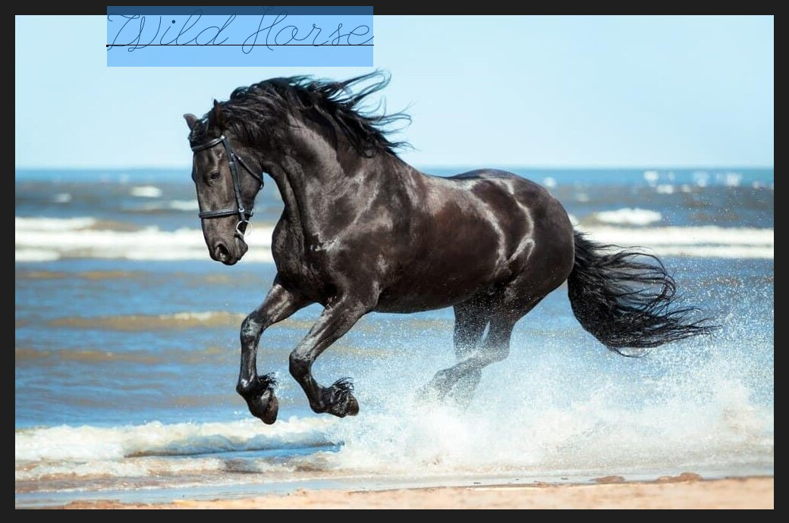

## Resizing text

Change the **size** in the Character panel or options bar. Pick a value from the list, or type a number and press `Enter`.
The text above went from 24 px to 72 px. The panel also has leading (line spacing), tracking (letter spacing), kerning,
vertical and horizontal scale, baseline shift and colour.

The buttons below those fields apply **Bold**, **Italic**, **All Caps**, **Small Caps**, **Superscript**, **Subscript**,
**Underline** and **Strikethrough**.

## The finished text layer

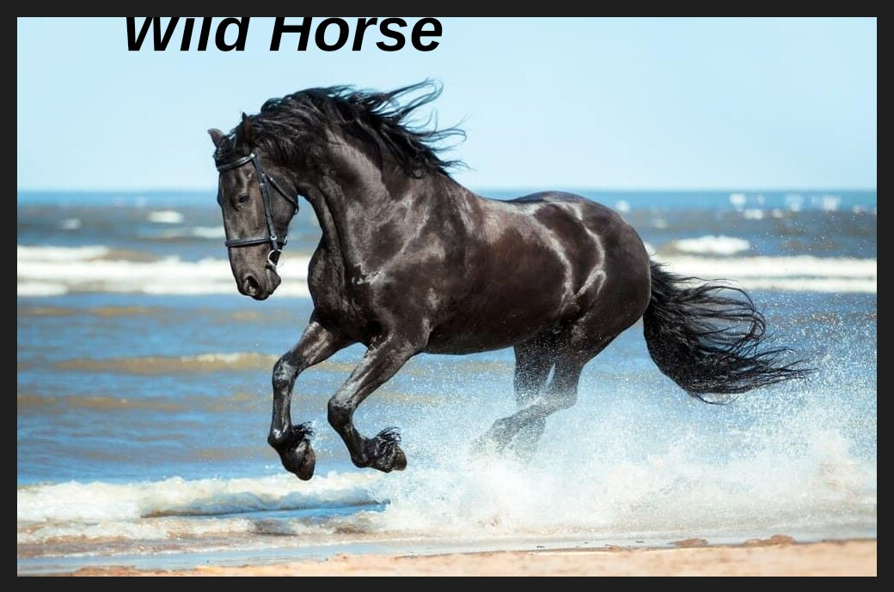

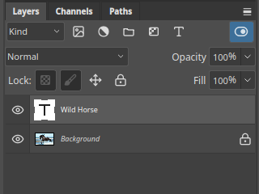

The **T** icon on the layer thumbnail shows that it is still live text. Double-click it to edit.

## Text layer masks

A text layer can have a [layer mask](layer-masks.md) like any layer. Click the **Add layer mask** button at the bottom of
the Layers panel, then click the mask thumbnail. Fill part of the mask with black to hide that part of the text.

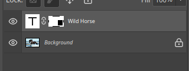

Here, the right end of the words has been hidden:

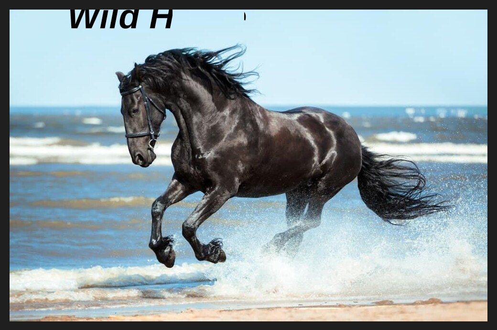

A gradient tool paints directly on the mask of a text layer: drag across it and the
text fades along the ramp. A selection with **Edit ▸ Fill…** does the same for a solid fill.

## Rasterizing text

Rasterizing turns live text into ordinary pixels. You can no longer edit the words, but you can paint on it or apply
filters that need pixels. Choose **Layer ▸ Rasterize ▸ Type**.

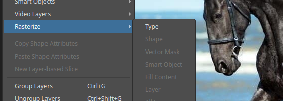

The other items, such as Shape and Smart Object, are for other kinds of layers and are greyed out here. Keep a
copy of the text layer if you may need to edit it later.

## Tips

- Use a [smart object](layers.md) or keep the text layer for as long as you can, since rasterizing cannot be undone
  except with History.
- Use **Paragraph Styles** and **Character Styles** to apply the same look to many pieces of text.
- Open the **Glyphs** panel to insert symbols and special characters.
