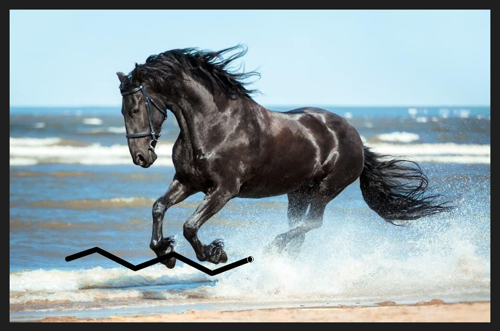
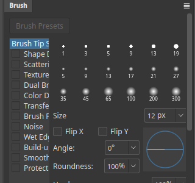

# Brush

The Brush paints strokes of the foreground colour. Select it in the toolbox and drag on the
canvas. Paint on a new layer so you can fix mistakes without touching the photo.

## The options bar

- **Brush size** and tip. Click the brush icon to choose a tip. Use `[` and `]` to make the
  brush smaller and larger.
- **Opacity** is how see-through the paint is.
- **Flow** is how quickly paint builds up as you drag.
- **Mode** is the blend mode of the paint.

## The Brush panel

Choose **Window ▸ Panels ▸ Brush** (`F5`) for more settings.

The list on the left holds groups such as **Brush Tip Shape**, **Shape Dynamics**,
**Scattering**, **Texture** and **Smoothing**. The tip shape page lets you set **Size**,
**Angle**, **Roundness**, **Hardness** and **Spacing**, and flip the tip.

## Tips

- Choose the colour in the Color or Swatches panel before you paint (see [Showing and hiding panels](panels-menu.md)).
- Use a soft brush on a [layer mask](layer-masks.md) to blend edges smoothly.
- Hold `Shift` and click to draw a straight line from the last point.
