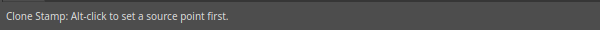

# Clone Stamp

The Clone Stamp paints with a copy of one part of the picture. Use it to cover a flaw or
repeat a texture.

## Using it

1. Pick the Clone Stamp in the toolbox.
2. Hold `Alt` and click on the area you want to copy. This sets the **source point**.
3. Release `Alt` and paint where you want the copy to appear.

Until you set a source, the status bar reads "Alt-click to set a source point first".

## The options bar

- **Brush size** and tip. Use `[` and `]` to change the size.
- **Mode**, **Opacity** and **Flow** work as for the [Brush](tool-brush.md).
- **Aligned** keeps the source moving with the brush. With it off, every stroke starts again from
  the original source point.
- **Sample** chooses which layers to copy from: the current layer, or others.

## Tips

- On some desktops, `Alt`+click is captured by the window manager to move windows. If the source
  does not set, change the window manager's modifier key.
- Clone on a new empty layer and set **Sample** to include other layers. This keeps the photo untouched.
- Pick a source with a similar tone and texture, and move the source point often.
- The **Clone Source** panel (**Window ▸ Panels ▸ Clone Source**) holds more settings.
