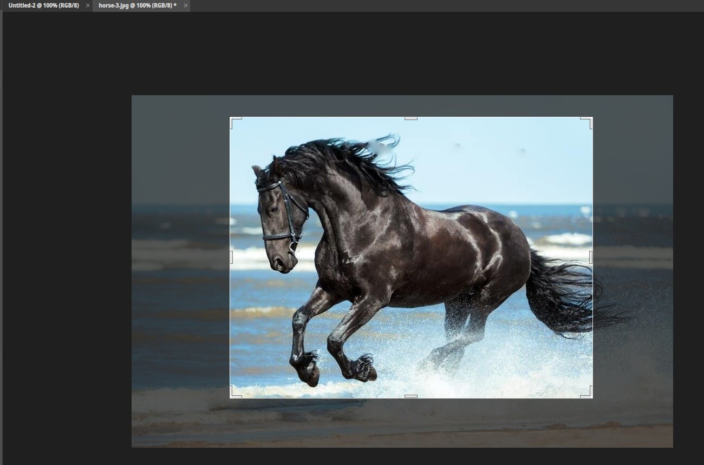
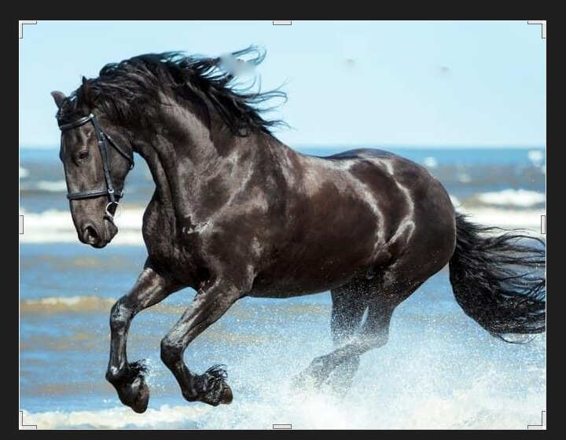

# Crop

The Crop tool trims the picture to the part you want to keep. It also improves composition and
changes the shape of the image.

## Using it

1. Pick the Crop tool. A box appears.
2. Drag across the picture, or drag the handles on the box, to choose the area to keep. The area
   outside the box is dimmed.
3. Press `Enter`, double-click inside the box, or click the tick in the options bar. Press `Esc` to cancel.

After applying, only the area in the box remains. The picture here went from 1000 × 652 pixels
to 670 × 520.

## The options bar

- **Ratio** sets a fixed shape, such as a square or 16:9. Choose **W x H** and type a size to set your own. The swap button turns
  it sideways.
- **Clear** removes the ratio.
- **Straighten** lets you drag a line along something that should be level, to rotate the picture.
- The grid button shows a guide overlay, such as thirds, and the cog holds more settings.
- **Delete Cropped Pixels** removes the outside area for good. Turn it off to keep it, hidden, so you can move the
  crop later.

## Tips

- Check what the status bar says: "drag the handles or a new box, Enter or double-click to apply, Esc to reset".
- **Image ▸ Canvas Size…** also changes the picture edges. See [Resizing an image](image-size.md).
- A crop also works from a selection: make one with the Marquee, then use **Image ▸ Crop**.
