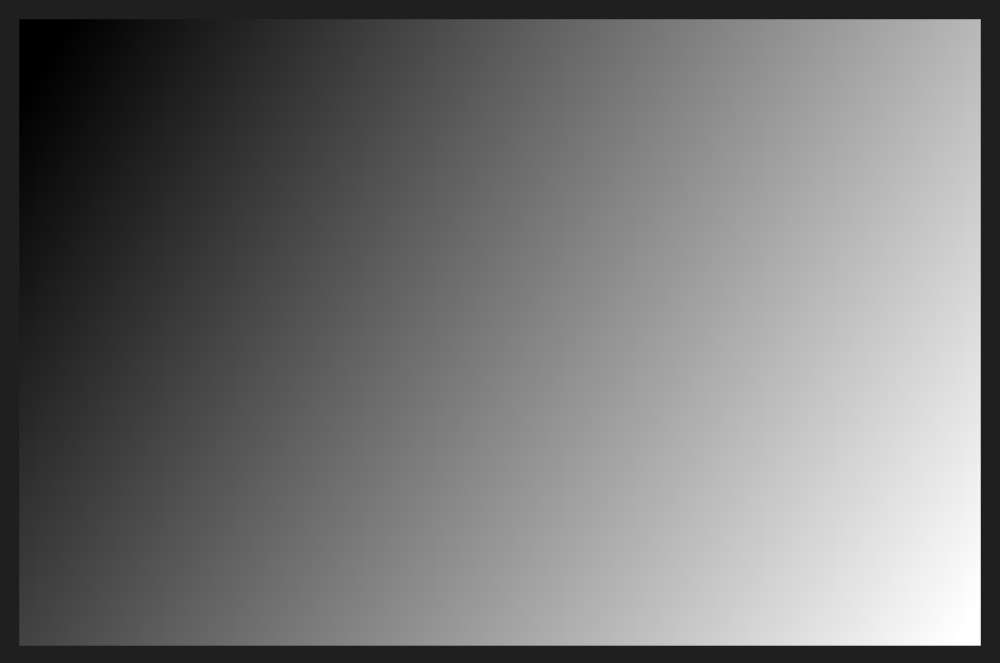
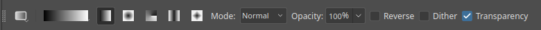
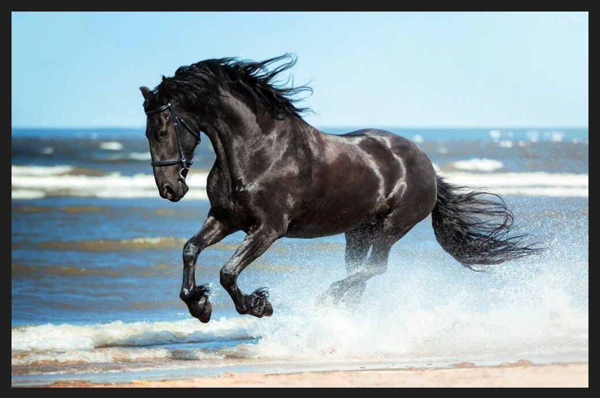
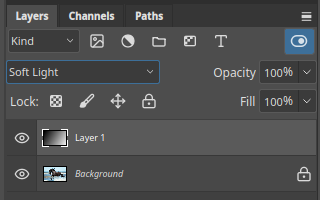

# Gradient

The Gradient tool fills with a smooth blend from one colour to another. By default it blends
from the foreground colour to the background colour.

## Draw one

1. Add a new layer, using the button at the bottom of the Layers panel.
2. Pick the Gradient tool.
3. Drag across the canvas. The start of the drag is the first colour and the end is the last.
   Hold `Shift` to keep the line at 45° steps.

## The options bar

- Click the **gradient preview** to choose or edit the colours.
- The five buttons beside it pick the shape: linear, radial, angle, reflected and diamond.
- **Mode** and **Opacity** control how the gradient mixes with the layer.
- **Reverse** flips the colours. **Dither** reduces banding. **Transparency** uses the
  gradient's own transparency.

## Blend it with the photo

A gradient on its own hides the photo. Change the layer's blend mode in the Layers panel, here
to **Soft Light**, and the gradient becomes a smooth darkening from the top left to the bottom
right.

See [Blend modes](blend-modes.md) for the other choices.

## Gradients on masks

A black-to-white gradient on a [layer mask](layer-masks.md) fades one layer into another.
