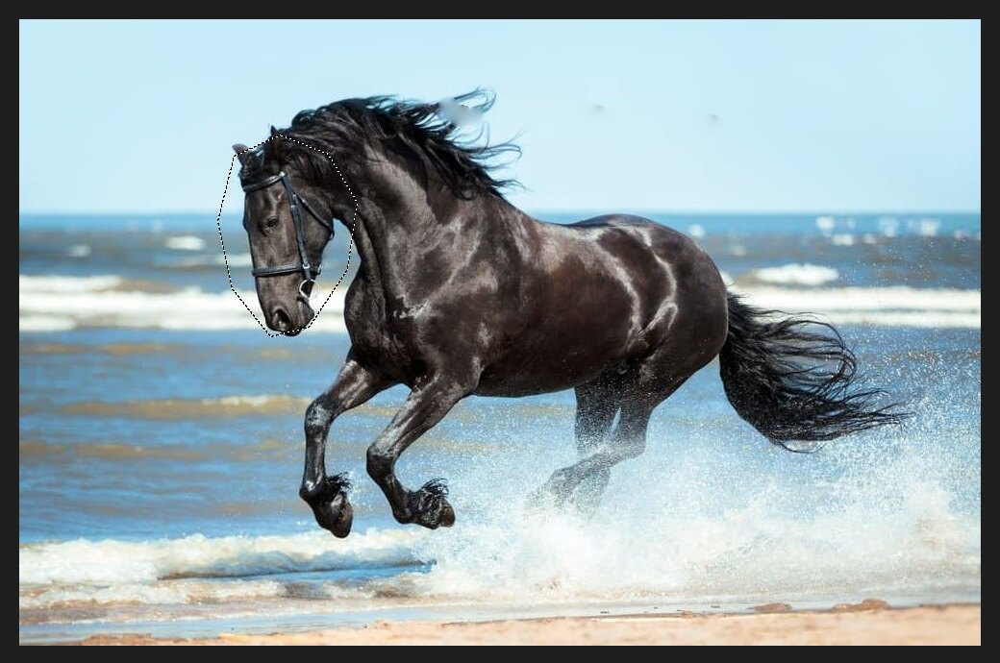

# Lasso

The Lasso selects by drawing around an area freehand.

## Using it

Pick the Lasso, then press and hold the mouse button and draw around the area. Release the button to
close the loop. The marching ants show the selection.

## The options bar

- The four buttons at the left choose how the selection combines with an existing one.
- **Feather** softens the edge by a number of pixels.
- **Anti-alias** smooths the edge.
- **Select and Mask…** opens the edge-refining tools.

## Other Lasso tools

The Lasso shares its place with two others:

- **Polygonal Lasso** draws straight segments. Click to place each corner.
- **Magnetic Lasso** snaps to the edges of objects as you move along them.

## Tips

- Zoom in for a more accurate selection.
- Use `Shift` to add another loop, and `Alt` to cut one out.
- For a clean edge, use [Refine Edge](selections-and-masking.md) afterwards.
