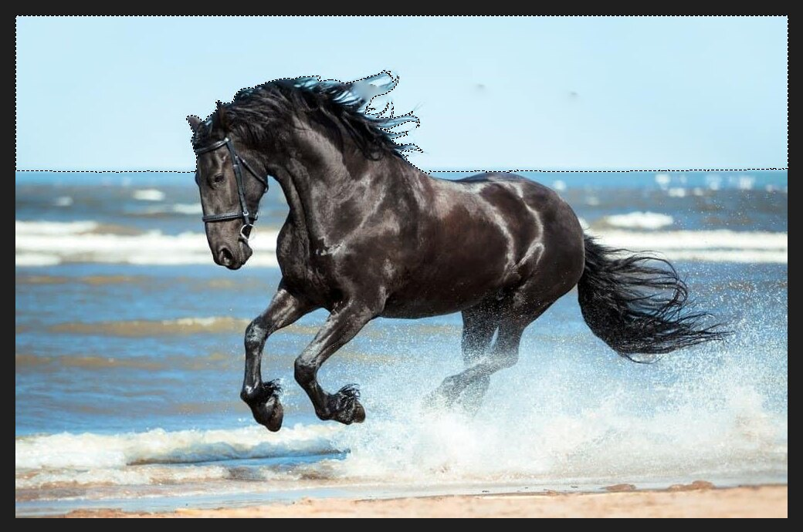

# Magic Wand

The Magic Wand selects an area of similar colour with a single click. It is quick for skies,
plain backgrounds and flat areas.

## Using it

Pick the Magic Wand, then click the colour you want to select. Here a click on the sky selects
the whole sky down to the horizon, and follows the edge of the horse's mane.

## The options bar

- The four buttons at the left choose how the click combines with an existing selection: new,
  add, subtract or intersect.
- **Tolerance** is how different a colour can be and still be selected. A low value picks a narrow
  range; a high value spreads the selection further. The default is 32.
- **Contiguous** limits the selection to touching areas. Turn it off to select the colour
  everywhere.
- **Anti-alias** smooths the edge.
- **Sample All Layers** reads the colours from every layer, not only the active one.
- **Select and Mask…** opens the edge-refining tools.

## Tips

- If the selection spills out, lower the tolerance. If it leaves gaps, raise it.
- Hold `Shift` and click to add more areas, or `Alt` and click to take some away.
- Press `Ctrl+Shift+I` to invert the selection, for example to select the horse instead of the
  sky.
- For hard-to-select subjects, try **Select ▸ Color Range…** or
  [Refine Edge](selections-and-masking.md).
