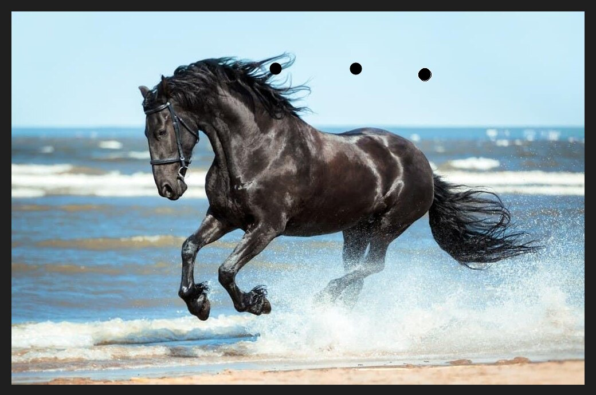
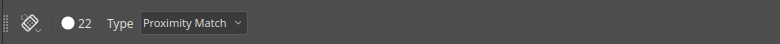

# Spot Healing

The Spot Healing Brush removes small flaws such as dust marks, spots and blemishes. It
samples the pixels around the flaw and blends them in, so you do not need to choose a source.

## Using it

1. Pick the Spot Healing Brush in the toolbox. It is first in the healing group.
2. Set the brush a little larger than the flaw, using `[` and `]`.
3. Drag across the flaw. The brush heals when you release.

Here three black dots were painted on the sky. After a short drag across each one, they are gone.

A faint trace can remain, especially close to detailed areas such as the mane. Drag across
the area once more, or use a slightly larger brush.

## The options bar

- **Brush size** and tip.
- **Type** chooses how the area is rebuilt. **Proximity Match** uses the pixels at the edge of
  the brush.

The status bar reminds you: click or drag over a defect to rebuild it from its surroundings.

## Tips

- A short drag works better than a single click.
- Work on a new layer and sample all layers, to keep the original photo intact.
- For larger areas, use the [Clone Stamp](tool-clone-stamp.md).
