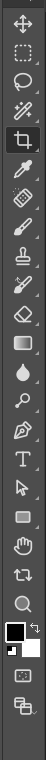

# The toolbox

The toolbox is the strip of tools down the left side of the window.

Click a tool to use it. The **options bar** under the menus then shows that tool's settings.
A small triangle at the corner of an icon means other tools are grouped under it.

## What is in it

From top to bottom:

- **Move**
- **Marquee** tools: rectangle and ellipse. See [Selections](selections-and-masking.md).
- **Lasso** tools. See [Lasso](tool-lasso.md).
- **Quick Selection** and **Magic Wand**. See [Magic Wand](tool-magic-wand.md).
- **Crop** tools. See [Crop](tool-crop.md).
- **Eyedropper**, colour sampler, ruler, note and count
- **Healing** tools. See [Spot Healing](tool-spot-healing.md).
- **Brush**, pencil and colour replacement. See [Brush](tool-brush.md).
- **Clone Stamp** and pattern stamp. See [Clone Stamp](tool-clone-stamp.md).
- **History Brush** tools
- **Eraser** tools. See [Eraser, Dodge, Burn and Sponge](tool-eraser-dodge-burn.md).
- **Gradient** and paint bucket. See [Gradient](tool-gradient.md).
- **Blur, Sharpen** and **Smudge**
- **Dodge, Burn** and **Sponge**
- **Pen** tools. See [Paths](paths.md).
- **Type** tools
- **Path Selection** tools
- **Shape** tools
- **Hand**, **Rotate View** and **Zoom**

At the bottom are the **foreground and background colours**, and a button for **Quick Mask** mode.

## Shortcuts

- Press `D` to reset the colours to black and white, and `X` to swap them.
- Hover over a tool for its name.
- The status bar at the bottom of the window explains what the active tool can do.
